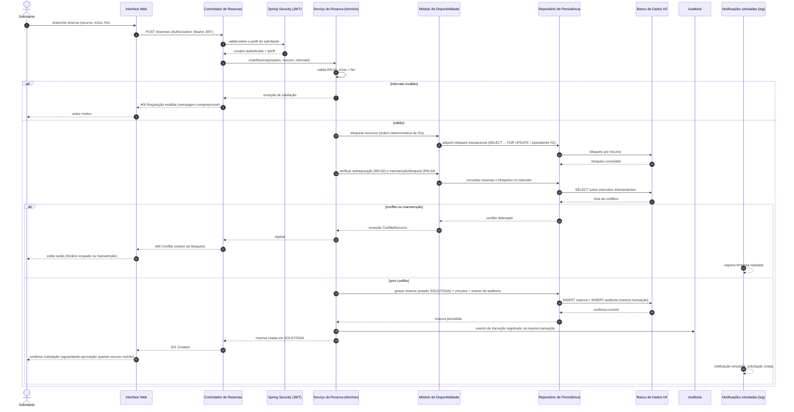
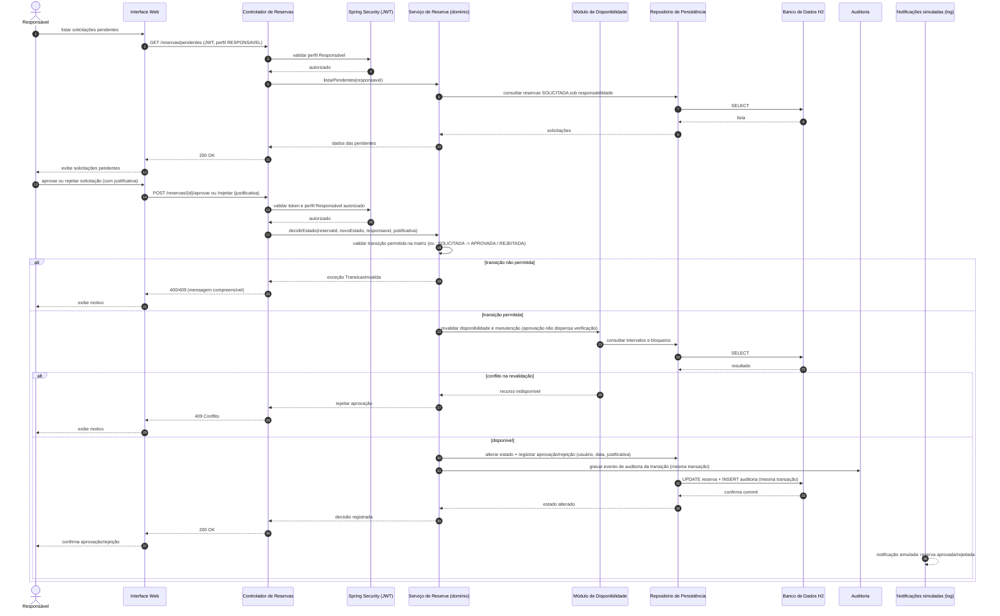
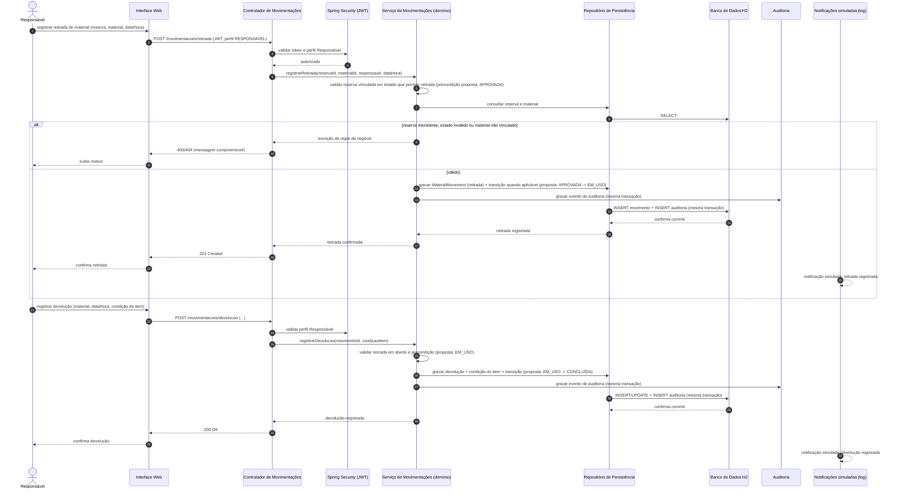
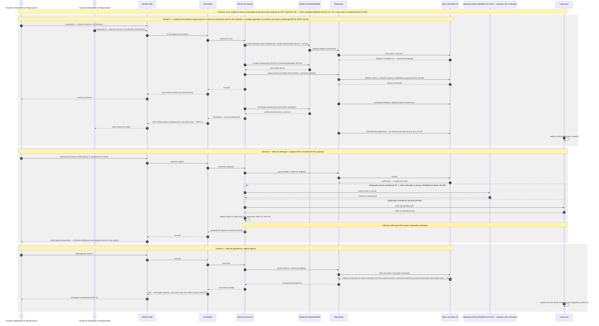

# RTM.md — Matriz de Rastreabilidade e Documentação Arquitetural

Sistema de Organização de Recursos — Disciplina Qualidade 2026.2

**Status:** Proposta arquitetural — documento de planejamento, sem implementação executada  
**Versão:** 1.0  
**Data:** 15/10/2026  
**Fontes de referência (preservadas, não modificadas):**
- `docs/arquitetura.md` — decisões arquiteturais existentes (AD-01 a AD-09 e seções 1 a 20)
- `docs/PRD.md` — Product Requirement Document (RF-01 a RF-14, RN-01 a RN-09, RNF-01 a RNF-05, COV-01/02, RTM-01, SEC-01, QUAL-01, RISK-01, entregáveis)
- `rfc/requisitos-funcionais.md` — RFC RF-01 a RF-20
- `rfc/requisitos-nao-funcionais.md` — RFC RNF-01 a RNF-18
- `docs/personas/solicitante.md`, `docs/personas/responsavel.md`, `docs/personas/administrador.md`
- `README.md`

---

## Convenções deste documento

- **Confirmado:** requisito, decisão ou fato expresso nos documentos-fonte (PRD, RFCs, arquitetura.md, personas, README).
- **Proposta:** decisão arquitetural sugerida neste documento, ainda não confirmada como fato implementado. Requer validação/revisão da equipe.
- **Pendente:** informação ausente nos documentos-fonte que exige decisão da equipe; não deve ser preenchida com invenção de dados.
- **Não implementado:** nada neste documento afirma que código, teste, pipeline, cobertura ou evidência foi executado. Tudo descrito é planejamento.
- Identificadores de requisito mantêm a origem do documento (ex.: PRD RF-01, RFC RF-01, RFC RNF-08).

---

## 1. Análise dos requisitos e do contexto

### 1.1 Personas e objetivos

| Persona | Perfil (PRD) | Objetivo | Ações permitidas (documentadas) | Restrições (documentadas) | Limite de autorização |
|---|---|---|---|---|---|
| Solicitante | USR-01 — Professor ou coordenador | Consultar disponibilidade e gerenciar reservas próprias de forma autônoma | Consultar disponibilidade; criar, alterar e cancelar próprias reservas | Não aprovar terceiros; não gerenciar cadastros; não alterar reservas de outros; sem acesso administrativo global | Apenas reservas próprias |
| Responsável | USR-02 — Gestor/coordenador | Acompanhar, validar e registrar uso de recursos e materiais | Analisar/aprovar/rejeitar solicitações especiais; validar alocação de docentes; registrar retirada e devolução; acompanhar estado | Não configurações globais; não gerencia todos os parâmetros; não cadastra/edita usuários/salas/materiais em nível global | Sob responsabilidade atribuída (vínculo não definido nos fontes — GAP) |
| Administrador | USR-03 — Gestor do sistema | Administração centralizada de recursos, permissões e regras operacionais | Cadastrar/editar/excluir salas, materiais, equipamentos, usuários; definir bloqueios e manutenção; definir permissões e parâmetros | Deve preservar integridade e disponibilidade | Privilégios globais, mas sem contornar validações de integridade, auditoria ou segurança (arquitetura.md §3.2) |

### 1.2 Requisitos funcionais obrigatórios

| ID | Origem | Descritivo resumido | Criticidade para avaliação |
|---|---|---|---|
| RF-01 | PRD / RFC RF-01 | Autenticação e autorização por perfil (Solicitante, Responsável, Administrador) com JWT | Crítica — limitador de nota (falha de autorização inviabiliza) |
| RF-02 | PRD / RFC RF-02 | Cadastro e consulta completa de salas, professores e materiais | Alta |
| RF-03 | PRD / RFC RF-03 | Pesquisa parametrizada por tipo, capacidade, localização, competência e disponibilidade | Alta |
| RF-04 | PRD / RFC RF-04, RF-05 | Criação, consulta, alteração e cancelamento de reservas com ciclo de estados | Alta |
| RF-05 | PRD / RFC RF-06 | Detecção e prevenção de sobreposição de horários (salas, professores, materiais) | Crítica |
| RF-06 | PRD / RFC RF-07 | Prevenção de dupla reserva em solicitações concorrentes (integridade transacional) | Crítica — limitador de nota (dupla reserva inviabiliza) |
| RF-07 | PRD / RFC RF-08 | Aprovação obrigatória de Responsável para recursos restritos | Alta |
| RF-08 | PRD / RFC RF-09 | Bloqueio de reserva em períodos de manutenção | Alta |
| RF-09 | PRD / RFC RF-10 | Registro formal de retirada e devolução de materiais e equipamentos | Alta |
| RF-10 | PRD / RFC RF-11 | Histórico auditável de alterações e transições de estado | Alta |
| RF-11 | PRD / RFC RF-17 | Notificação simulada ou integração com API externa | Média (opção aberta nos fontes) |
| RF-12 | PRD / RFC RF-12 | Relatórios de utilização, carga horária alocada, conflitos evitados | Alta |
| RF-13 | PRD / RFC RF-13 | Interface responsiva com mensagens de erro compreensíveis | Alta |
| RF-14 | PRD / RFC RF-14 | Documentação técnica da API/fluxos públicos | Média |
| RF-15 | RFC RF-15 | Controle de acesso estrito por perfil | Crítica |
| RF-16 | RFC RF-16 | Solicitante manipula apenas reservas próprias | Crítica |
| RF-17 | RFC RF-17 | Aprovação/rejeição de solicitações especiais pelo Responsável | Alta |
| RF-18 | RFC RF-18 | Administração global pelo Administrador | Alta |
| RF-19 | RFC RF-19 | Validação do JWT antes da execução de operações protegidas | Crítica |
| RF-20 | RFC RF-20 | Testes de borda e cenários críticos (horários inválidos, sobreposição, manutenção, perfil, concorrência) | Alta |

### 1.3 Regras de negócio (RN)

| ID | Origem | Regra |
|---|---|---|
| RN-01 | PRD / RFC | Término obrigatoriamente posterior ao início da reserva |
| RN-02 | PRD / RFC | Exclusividade de alocação: sem sobreposição de horário para mesmo recurso (sala, material ou professor) |
| RN-03 | PRD / RFC | Atomicidade sob concorrência: duas solicitações simultâneas para mesmo recurso/horário resultam em no máximo uma reserva aceita |
| RN-04 | PRD / RFC | Recurso em manutenção não pode ser reservado |
| RN-05 | PRD / RFC | Fluxo nominal estrito: SOLICITADA → APROVADA → EM_USO → CONCLUÍDA |
| RN-06 | PRD / RFC | Estados alternativos admitidos: REJEITADA, CANCELADA, NÃO COMPARECEU |
| RN-07 | PRD / RFC | Somente perfil Responsável aprova solicitações de recursos restritos |
| RN-08 | PRD / RFC | Reservas iniciadas (EM_USO) não podem ser excluídas |
| RN-09 | PRD / RFC | Toda mudança de estado gera registro de auditoria imutável |

### 1.4 Restrições técnicas e atributos de qualidade

**Restrições técnicas confirmadas nos fontes:**
- Linguagem principal: Java (PRD 1.1)
- Backend: Spring Boot com ecossistema Spring (regras de negócio, autenticação, autorização, endpoints) (PRD 1.1)
- Persistência: H2 banco de dados relacional (PRD 1.1)
- Interface web: HTML e CSS integrados ao Spring, renderização pelas páginas pela aplicação, responsiva (PRD 1.1)
- Autenticação: JWT (RF-01, RNF-01, arquitetura.md AD-03)
- Não há exigência de microsserviços, mensageria, cache, API externa obrigatória ou app móvel (arquitetura.md §3.1)

**Atributos de qualidade (RNF e PRD):**
- Segurança de autenticação e autorização (RNF-01)
- Integridade e proteção contra concorrência (RNF-02)
- Tempo de resposta: consultas ≤ 1s (alvo 500 ms), ações de disparo ≤ 1s (alvo 500 ms), relatórios ≤ 5s (alvo 2,5s) — documentados em arquitetura.md §11.1; *GAP: os arquivos RFC não trazem esses valores numéricos, apenas referenciam "limites de tempo de resposta" (ver 1.6)*
- Robustez sob carga com JMeter (RNF-01 PRD, RNF-06 RFC)
- Validação de entrada e tratamento seguro de erros sem exposição de dados sensíveis (RNF-02 PRD, RNF-07 RFC)
- Ambiente realista de testes: Testcontainers para persistência, WireMock para integrações externas, mocks restritos a unitários isolados (RNF-03 PRD, RNF-08 RFC)
- CI via GitHub Actions a cada pull request (RNF-04 PRD, RNF-09 RFC)
- TDD ou BDD em pelo menos uma funcionalidade crítica (RNF-05 PRD, RNF-10 RFC)
- Cobertura: linhas ≥ 80%, branches ≥ 70% via JaCoCo (COV-01, COV-02, RNF-11)
- Auditoria, rastreabilidade e histórico persistente (RNF-12 RFC)
- Observabilidade e diagnósticos (RNF-15, RNF-16)
- SonarCloud: 0 bugs e 0 vulnerabilidades críticos (SEC-01)
- Qualidade dos testes: não por asserções triviais (QUAL-01)
- RTM 100% dos requisitos críticos rastreados (RTM-01)

### 1.5 Drivers arquiteturais classificados por importância e criticidade

| Driver | Importância | Criticidade | Fundamento |
|---|---|---|---|
| D1 — Aplicação executável e demonstrável | Crítica | Eliminatória (limitador de nota) | PRD RISK-01, entregável 2 |
| D2 — Autorização correta por perfil | Crítica | Eliminatória | PRD RISK-01, RF-01/RF-15/RF-16/RF-19 |
| D3 — Prevenção de dupla reserva sob concorrência | Crítica | Eliminatória | PRD RISK-01, RF-06/RN-03/RNF-02 |
| D4 — Auditoria imutável de mudanças de estado | Alta | Não eliminatória, mas obrigatória | RF-10/RN-09/RNF-12 |
| D5 — Desempenho nas consultas de disponibilidade e pesquisa | Alta | Não eliminatória | RNF-03/RNF-04/RNF-05 |
| D6 — Testabilidade e evidências automatizadas de qualidade | Alta | Obrigatória (CI, cobertura, TDD/BDD) | RNF-04/RNF-08/RNF-10/RNF-11 |
| D7 — Segurança de entrada e tratamento de erros sem exposição interna | Alta | Obrigatória | RNF-02 PRD/RNF-07 |
| D8 — Simplicidade operacional e escopo acadêmico (monólito local, H2) | Média | Desejável | PRD 1.1, arquitetura.md AD-01/AD-02 |
| D9 — Rastreabilidade requisito → risco → teste → evidência | Alta | Obrigatória | RTM-01, PRD entregável 4 |

### 1.6 Requisitos explícitos, derivados, suposições e decisões pendentes

**Requisitos explícitos (presentes nos fontes):** tecnologias (Java, Spring Boot, H2, HTML/CSS), perfis e ações das personas, RF-01 a RF-20, RN-01 a RN-09, RNF-01 a RNF-18, estados das reservas, cobertura 80/70, CI GitHub Actions, SonarCloud 0 crítico, TDD/BDD, JMeter, Testcontainers/WireMock.

**Requisitos derivados (consequência lógica dos explícitos, não inventados):**
- Necessidade de camada de segurança que valide JWT antes de operações protegidas (RF-01, RF-19, RNF-01).
- Controle de concorrência na escrita de reservas para impedir dupla alocação (RF-06, RN-03, RNF-02).
- Persistência de auditoria na mesma transação da mudança de estado (RN-09, arquitetura.md AD-05).
- Separação entre perfil autorizado e propriedade da reserva (RF-16, arquitetura.md §14).

**Suposições provisórias (claramente identificadas, não são fatos):**
- S1 — Validade do token de acesso: 1 hora; refresh token: 7 dias (arquitetura.md AD-03, premissa acadêmica inicial).
- S2 — Algoritmo de assinatura JWT: RS256 (arquitetura.md AD-03, proposta inicial).
- S3 — H2 em arquivo para demonstração (preservação entre reinicializações); modo a definir (arquitetura.md AD-02).
- S4 — Intervalos de reserva tratados como semiabertos [início, fim) (arquitetura.md §7.2, convenção proposta).
- S5 — Recurso restrito representado por flag/classificação explícita; Administrador altera essa classificação (arquitetura.md §8.3, proposta).
- S6 — Solicitação especial tratada inicialmente como solicitação de recurso restrito (arquitetura.md §8.3, premissa a revisar).
- S7 — Volumes de referência de teste (100 usuários, 50 salas, 100 professores, 200 materiais, 10.000 reservas, 20 usuários virtuais simultâneos, 10 req/s, p95) — premissas de teste acadêmico de arquitetura.md §11.2, não fatos do PRD.
- S8 — Vínculo entre Responsável e solicitações/recursos "sob sua responsabilidade" não definido nos fontes; tratado como premissa (arquitetura.md §3.2).
- S9 — Percentil p95 como critério inicial de avaliação de desempenho (arquitetura.md §11.3, convenção acadêmica).

**Decisões ainda pendentes (não inventar valores):**
- P1 — Modo de execução do H2 (memória vs arquivo) não definido definitivamente.
- P2 — Configuração de Testcontainers com H2 (ou alternativa aprovada) para atender RNF-08 literalmente; arquitetura.md §12.3 registra a lacuna.
- P3 — Integração externa de notificação: RF-11 permite "simulada ou API externa"; nenhuma opção confirmada. AD-06 propõe logs locais, mas é decisão proposta.
- P4 — Política de retenção de auditoria e tratamento LGPD (prazos, categorias de dados pessoais) não especificados nos fontes.
- P5 — Critérios numéricos de desempenho (percentil, volume de usuários simultâneos, throughput) não especificados nos fontes; S7/S9 são premissas.
- P6 — Critérios de cancelamento (prazo, penalidades) não definidos.
- P7 — Critérios de NÃO_COMPARECEU (quem registra, após quanto tempo de ausência) não definidos.
- P8 — Existência de entidade "unidade organizacional" para filtro de relatórios não confirmada (arquitetura.md §10.2).
- P9 — Armazenamento de tokens no navegador e necessidade de CSRF/CORS não definidos (arquitetura.md §6.5, §14).
- P10 — Transições de estado além da matriz proposta não definidas nos fontes (matriz de arquitetura.md §8.2 é premissa acadêmica).

### 1.7 Requisitos críticos que podem inviabilizar a avaliação (limitadores de nota)

Conforme PRD RISK-01 e arquitetura.md conclusão, a ocorrência de qualquer um dos seguintes inviabiliza a aprovação máxima:
1. Aplicação que não executa.
2. Pipeline de CI ausente.
3. Falha de autorização (acesso/alteração indevida por perfil ou por propriedade).
4. Possibilidade de dupla reserva (duas reservas confirmadas para mesmo recurso e intervalo incompatível).

Esses quatro requisitos têm prioridade máxima sobre todos os demais.

---

## 2. Arquitetura e responsabilidades

### 2.1 Estilo e topologia arquitetural

**AD-01 (proposta, documentada em arquitetura.md):** Monólito modular Spring Boot, único processo executável, módulos com responsabilidades explícitas, comunicação interna por chamadas a serviços de aplicação/casos de uso, endpoints HTTP para interface e clientes autorizados.

Justificativa: evita complexidade operacional de serviços distribuídos, mantém aderência às tecnologias do PRD (Java, Spring Boot, H2, HTML/CSS) e é adequada ao escopo acadêmico.

Alternativas consideradas e rejeitadas/não adotadas:
- Microsserviços: complexidade operacional incompatível com escopo acadêmico e sem requisito que o justifique.
- Camadas apenas lógicas sem módulos: limites fracos, risco de dependências circulares e acoplamento.
- Mensageria/cache: não exigidos pelos fontes; adicionariam custo sem justificativa de requisito.

**Não é microserviço, não há mensageria, não há cache imposto.** Qualquer adição futura deve ser justificada por requisito ou atributo de qualidade identificável.

### 2.2 Módulos, responsabilidades e limites de contexto

| Módulo | Responsabilidades | Limite de contexto / propriedade dos dados |
|---|---|---|
| `identity` | Login, emissão de tokens JWT, renovação (refresh), logout/revogação, identidade do usuário autenticada | Usuários, credenciais (senha hasheada), refresh tokens (hashed), perfis |
| `resources` | Cadastro, consulta, classificação, situação de salas, professores, materiais e equipamentos | Recursos, tipos, localização, capacidade, competência, situação, classificação de restrição |
| `availability` | Agendas, bloqueios, manutenção, verificação de conflitos de intervalo | AvailabilityBlock, Maintenance, períodos de indisponibilidade |
| `reservations` | Criação, alteração, cancelamento, consulta, aprovação, ciclo de vida, transições de estado | Reservas, vínculos reserva-recurso, estados, dados de aprovação |
| `movements` | Registro de retirada e devolução de materiais/equipamentos, condição do item | MaterialMovement, histórico de movimentação |
| `audit` | Registro e consulta de eventos de auditoria (transições, alterações) | AuditEvent (append-only) |
| `reports` | Relatórios gerenciais, filtros, agregações (utilização, carga horária, conflitos evitados, retiradas/devoluções, manutenção) | Consultas de leitura agregada sobre os dados dos demais módulos |
| `notifications` | Notificações simuladas por logs locais | Nenhuma persistência própria; emite eventos de observabilidade |
| `shared` | Tratamento centralizado de erros, contratos de resposta, identificação do usuário autenticado | Componentes transversais, sem regras de negócio |

**Regras de dependência e separação de responsabilidades:**
- Direção de dependência: Interface/Web → Controladores → Camada de aplicação → Domínio → Infraestrutura/Persistência.
- Regras de domínio não dependem de controladores HTTP nem de componentes de interface.
- Nenhuma dependência circular entre módulos.
- `shared` é usado por todos, mas não depende de módulos de negócio.
- O domínio valida invariantes (ordem temporal, sobreposição, transições permitidas) independentemente da camada de entrada.

### 2.3 Interfaces públicas e contratos de API (propostos)

Os contratos exatos (payloads, nomes de endpoints) não estão definidos nos fontes. A tabela abaixo é **proposta** e deve ser confirmada na implementação/documentação de API exigida por RF-14.

| Método | Endpoint | Acesso | Objetivo | Status |
|---|---|---|---|---|
| POST | /auth/login | Público | Autenticar e emitir access + refresh token | Proposta (arquitetura.md §6.5) |
| POST | /auth/refresh | Público com refresh token válido | Renovar tokens | Proposta |
| POST | /auth/logout | Autenticado | Revogar sessão de renovação | Proposta |
| GET | /auth/me | Autenticado | Consultar identidade e perfis do usuário | Proposta |
| GET | /recursos | Autenticado (perfis conforme matriz) | Consultar recursos com filtros | Proposta |
| POST | /recursos | Administrador | Cadastrar recurso | Proposta |
| GET | /reservas | Autenticado | Listar reservas (próprias ou sob responsabilidade) | Proposta |
| POST | /reservas | Autenticado | Criar reserva (estado SOLICITADA) | Proposta |
| PUT | /reservas/{id} | Proprietário / Responsável autorizado | Alterar reserva | Proposta |
| DELETE | /reservas/{id} | Proprietário (antes do início) | Cancelar reserva | Proposta |
| POST | /reservas/{id}/aprovar | Responsável autorizado | Aprovar solicitação | Proposta |
| POST | /reservas/{id}/rejeitar | Responsável autorizado | Rejeitar solicitação | Proposta |
| POST | /movimentacoes/retirada | Responsável | Registrar retirada | Proposta |
| POST | /movimentacoes/devolucao | Responsável | Registrar devolução | Proposta |
| GET | /relatorios/* | Responsável / Administrador | Relatórios gerenciais | Proposta |

**Contrato de erro (proposto, alinhado a RNF-07):** respostas consistentes sem stack traces, senhas, tokens, consultas SQL ou caminhos internos. Códigos HTTP propostos: 400 (requisição inválida), 401 (não autenticado), 403 (sem permissão), 404 (recurso inexistente), 409 (conflito de reserva/sobreposição), 500 (erro inesperado).

### 2.4 Estratégia de persistência e transações

**AD-02 (confirmada como tecnologia, modo pendente P1):** H2 relacional como banco de persistência local (PRD 1.1, arquitetura.md AD-02). Modo arquivo vs memória: decisão pendente (arquitetura.md recomenda arquivo para demonstração).

Estratégia de transações (proposta):
- Operações de criação/alteração/cancelamento de reserva executadas em transação `@Transactional`.
- Verificação de disponibilidade, sobreposição e manutenção, e gravação da reserva, na mesma transação (AD-04).
- Mudança de estado da reserva e evento de auditoria persistidos na mesma transação (AD-05, RN-09).
- Leituras de consulta executadas como `@Transactional(readOnly=true)`.
- Consultas parametrizadas (Spring Data/JDBC) para prevenir injeção SQL (arquitetura.md §14).

Entidades conceituais (arquitetura.md §5.2, preservadas): User, Resource, Reservation, ReservationResource, AvailabilityBlock, Maintenance, MaterialMovement, AuditEvent, RefreshToken.

### 2.5 Tratamento de erros, validações e respostas

- Validação de entrada com Bean Validation (Jakarta Validation) + regras específicas de domínio (arquitetura.md §14).
- O usuário autenticado é derivado do contexto de segurança (Spring Security), nunca de identificador fornecido livremente pelo cliente (RF-16).
- Tratamento centralizado de exceções (ControllerAdvice proposto).
- Respostas de erro com causa e ação esperada, sem exposição interna (RF-13, RNF-07).
- Reservas em `EM_USO` não podem ser excluídas; alterações em reservas iniciadas bloqueadas (RN-08, arquitetura.md §8.2).

### 2.6 Integrações externas e isolamento para testes

- Nenhuma integração externa é obrigatória nos fontes (arquitetura.md §3.1). RF-11 oferece alternativa: notificação simulada **ou** integração com API externa — decisão pendente (P3).
- AD-06 (proposta): notificações simuladas exclusivamente por logs locais, sem persistência própria; falha de logging não reverte operação de negócio confirmada.
- Isolamento para testes (RNF-08): persistência validada em ambiente realista (Testcontainers — configuração pendente P2); WireMock apenas se houver integração externa a simular (nenhuma confirmada no escopo).

---

## 3. Modelagem das regras críticas de negócio

Para cada regra crítica abaixo são informados: onde é validada, mecanismo de integridade, proteção contra concorrência/inconsistência, testes que comprovam, evidência esperada.

### 3.1 Autenticação e autorização por perfil (RF-01, RF-15, RNF-01)

- **Onde validada:** Filtros Spring Security em cada endpoint protegido (RF-19: validação antes da execução); regras de acesso no serviço de aplicação; verificação de propriedade no serviço de domínio.
- **Mecanismo:** JWT com claims (`sub`, `roles`, `iss`, `aud`, `iat`, `exp`, `jti`); validação de assinatura, emissor, audiência, expiração e claims obrigatórios (arquitetura.md §6.2–6.3); senhas armazenadas com hash (BCrypt proposto); refresh token opaco, hashed, com rotação e revogação.
- **Concorrência:** renovação de refresh token controlada transacionalmente para impedir reutilização (arquitetura.md §6.4).
- **Testes:** login válido/inválido, token expirado, token ausente, acesso sem perfil suficiente, tentativa de Solicitante alterar reserva de terceiro.
- **Evidência:** relatórios de testes de segurança, matriz de autorização (arquitetura.md §6.6), logs de eventos de autenticação sem credenciais.

### 3.2 Cadastro e consulta de salas, professores e materiais (RF-02, RF-03)

- **Onde validada:** módulo `resources` (camada de aplicação e domínio); filtros de pesquisa no serviço de disponibilidade.
- **Mecanismo:** validação de campos obrigatórios; recursos em manutenção/indisponíveis não expostos como disponíveis para reserva (RF-02 critério de aceite).
- **Concorrência:** leitura consistente; cadastros exclusivos por identificador (constraint de unicidade proposta).
- **Testes:** cadastro com dados válidos/inválidos, consulta por filtros (tipo, capacidade, localização, competência, disponibilidade), exclusão de recurso com reservas ativas (regras a definir — pendente).
- **Evidência:** testes de integração de repositório e testes de API caixa-preta.

### 3.3 Pesquisa por tipo, capacidade, localização, competência e disponibilidade (RF-03)

- **Onde validada:** módulos `resources` e `availability`.
- **Mecanismo:** consulta sobre dados de recurso e períodos bloqueados/manutenção; apenas recursos compatíveis retornados.
- **Concorrência:** leitura de snapshot; não há gravação nesta operação.
- **Testes:** combinação de filtros, filtro sem resultado, filtro por período indisponível.
- **Evidência:** casos de teste parametrizados e relatório de execução.

### 3.4 Criação, alteração e cancelamento de reservas (RF-04)

- **Onde validada:** módulo `reservations` (serviço de domínio).
- **Mecanismo:** validação de início < fim (RN-01), estado inicial SOLICITADA, transições permitidas, validação de disponibilidade e conflitos.
- **Concorrência:** controle transacional com bloqueio/serialização (AD-04).
- **Testes:** criação com intervalo válido, alteração de reserva própria, cancelamento de reserva própria, tentativa de alterar reserva de terceiro (403), cancelamento de reserva em EM_USO (rejeitado).
- **Evidência:** testes de domínio e de integração com banco real.

### 3.5 Validação de início e término dos intervalos (RN-01)

- **Onde validada:** domínio da reserva, antes de qualquer consulta de disponibilidade.
- **Mecanismo:** regra de negócio explícita `fim > início`; intervalos semeabertos `[início, fim)` como convenção proposta (S4).
- **Concorrência:** não se aplica (validação local prévia).
- **Testes:** fim igual ao início (inválido), fim antes do início (inválido), fim posterior (válido), duração zero.
- **Evidência:** testes unitários parametrizados de regra de domínio.

### 3.6 Detecção de sobreposição de horários (RF-05, RF-06, RN-02)

- **Onde validada:** módulo `availability`, dentro da transação de reserva.
- **Mecanismo:** condição de conflito `inicio_existente < fim_novo AND fim_existente > inicio_nivo` (arquitetura.md §7.2), aplicada a salas, professores e materiais; períodos de manutenção/bloqueio tratados como indisponibilidade (RN-04).
- **Concorrência:** consulta prévia **não é suficiente**; requer bloqueio/serialização na gravação (AD-04).
- **Testes:** sobreposição parcial, contenção total, fim igual ao início de outro (não conflita sob convenção semiaberta), toque de borda.
- **Evidência:** testes de integração concorrentes e consulta de estado final do banco.

### 3.7 Prevenção de dupla reserva em solicitações concorrentes (RF-06, RF-07, RN-03, RNF-02)

- **Onde validada:** serviço de reservas + repositório, na mesma transação de gravação.
- **Mecanismo:** bloqueio transacional por recurso (ordem determinística de IDs para evitar deadlock — arquitetura.md §7.1) ou equivalente de serialização compatível com H2; restrição única de banco **não é suficiente isoladamente** para intervalos arbitrários (arquitetura.md §7.1); tratamento de violações de integridade e conflitos concorrentes.
- **Concorrência:** no máximo uma operação confirma; a outra recebe 409 Conflito; nenhuma resposta indica sucesso sem commit confirmado; estado final do banco é a prova (não apenas código HTTP).
- **Testes:** teste de concorrência com pelo menos 10 requisições simultâneas disputando mesmo recurso e intervalo (arquitetura.md §11.2), múltiplas execuções, verificação de que no máximo uma reserva é aceita.
- **Evidência:** resultado do teste de concorrência, dump do estado final do banco, relatório de execução.

### 3.8 Aprovação obrigatória de recursos restritos (RF-07, RF-08, RF-17, RN-07)

- **Onde validada:** serviço de reservas + módulo de auditoria; autorização por perfil Responsável.
- **Mecanismo:** recurso restrito com flag explícita (S5); apenas Responsável autorizado aprova; aprovação registrada (usuário, data, decisão, justificativa); ausência de aprovação não é aprovação implícita; aprovação não dispensa verificação de disponibilidade/manutenção/conflito.
- **Concorrência:** aprovação e gravação de estado na mesma transação; revalidação de disponibilidade no momento da aprovação.
- **Testes:** aprovação por Responsável autorizado, rejeição por Solicitante (403), solicitação de recurso restrito sem aprovação não entra em EM_USO, registro de quem aprovou/rejeitou.
- **Evidência:** testes de autorização, eventos de auditoria de transição, relatório de aprovações.

### 3.9 Bloqueio de recursos em manutenção (RF-08, RN-04)

- **Onde validada:** módulo `availability` no fluxo de reserva e na aprovação.
- **Mecanismo:** períodos de manutenção cadastrados vinculados ao recurso; interseção entre período solicitado e intervalo bloqueado implica rejeição (arquitetura.md §7.4).
- **Concorrência:** mesmo mecanismo de bloqueio transacional da criação de reserva.
- **Testes:** reserva que intersecte manutenção é rejeitada; reserva fora do período de manutenção é aceita; motivo do bloqueio exibido na API/interface.
- **Evidência:** testes de integração e de API caixa-preta com mensagem de bloqueio.

### 3.10 Registro de retirada e devolução de materiais (RF-09, RF-10)

- **Onde validada:** módulo `movements`; perfil Responsável.
- **Mecanismo:** retirada vinculada a reserva aprovada (precondição proposta: APROVADA → EM_USO); devolução com validação de estado do item e retirada em aberto (proposta: EM_USO → CONCLUÍDA); histórico persistido para auditoria.
- **Concorrência:** gravação de movimento e auditoria na mesma transação.
- **Testes:** retirada com dados válidos, devolução com condição do item, tentativa de retirada sem reserva aprovada (rejeitada), devolução sem retirada em aberto (rejeitada).
- **Evidência:** testes de integração, eventos de auditoria, histórico de movimentação.

### 3.11 Histórico auditável das alterações (RF-10, RN-09, RNF-12, AD-05)

- **Onde validada:** módulo `audit`, acionado pelo domínio em cada transição/alteração relevante.
- **Mecanismo:** append-only na aplicação (apenas inclusão); evento gravado na mesma transação da mudança de estado; campos: identificador do evento, usuário, data/hora UTC, entidade e identificador afetado, ação, estado anterior e posterior, resultado, justificativa, ID de correlação (arquitetura.md §9.1).
- **Concorrência:** persistência transacional garante que não há estado sem auditoria correspondente.
- **Testes:** cada mudança de estado gera evento; tentativa de editar/excluir evento de auditoria não oferecida pela aplicação; consulta ao histórico.
- **Evidência:** tabela de eventos de auditoria, testes de imutabilidade, consulta histórica.

### 3.12 Notificações simuladas (RF-11, RNF-16, AD-06)

- **Onde validada:** módulo `notifications` (logs locais).
- **Mecanismo:** emissão de log para eventos (solicitação criada, aprovada/rejeitada, cancelada, início/conclusão, manutenção, retirada/devolução, falha crítica); falha de logging não reverte negócio.
- **Concorrência:** assíncrona ao negócio; não é dependência transacional.
- **Testes:** verificação de que logs são emitidos para eventos esperados; operação de negócio prossegue mesmo se logging falhar (proposto).
- **Evidência:** amostras de log, teste de falha de logging não revertendo transação.

*GAP (P3):* RF-11 permite integração com API externa; nenhuma integração externa confirmada. Se a equipe optar por API externa, WireMock deve simular em testes (RNF-08).

### 3.13 Relatórios de utilização (RF-12)

- **Onde validada:** módulo `reports` (leitura agregada).
- **Mecanismo:** filtros (data, unidade, recurso, status — unidade pendente P8), agregações, autorização sobre o conjunto de dados.
- **Concorrência:** leitura apenas; consistência dos dados no momento da geração.
- **Testes:** utilização por recurso, carga horária alocada, reservas por estado, conflitos evitados, histórico de retiradas/devoluções, tempo de resposta (referência ≤ 5s / alvo 2,5s documentado em arquitetura.md §11.1).
- **Evidência:** relatórios gerados, testes de desempenho de relatório.

### 3.14 Ciclo de vida das reservas — estados e transições

**Estados documentados (PRD RN-05/RN-06, RFC RF-05):**
- `SOLICITADA` (estado inicial de criação — RFC RF-05)
- `APROVADA`
- `EM_USO`
- `CONCLUÍDA`
- `REJEITADA`
- `CANCELADA`
- `NÃO_COMPARECEU` (grafia conforme PRD: "NÃO COMPARECEU"; neste documento adotada a forma com sublinhado para uso em código/enum: `NÃO_COMPARECEU`)

**Fluxo nominal (RN-05):** `SOLICITADA → APROVADA → EM_USO → CONCLUÍDA`.

**Matriz de transições proposta (premissa acadêmica — arquitetura.md §8.2; não todos os atores/transições estão definidos nos fontes):**

| Estado atual | Estado de destino | Condição proposta | Responsável pela transição | Efeito | Auditoria obrigatória |
|---|---|---|---|---|---|
| SOLICITADA | APROVADA | Aprovação por Responsável autorizado (quando recurso restrito ou regra aplicável) | Responsável | Estado muda; aprovação registrada (usuário, data, justificativa) | SIM |
| SOLICITADA | REJEITADA | Rejeição por Responsável autorizado | Responsável | Estado muda; rejeição registrada | SIM |
| SOLICITADA | CANCELADA | Cancelamento pelo Solicitante proprietário (antes do início, política a definir — P6) | Solicitante | Estado muda; cancelamento registrado | SIM |
| APROVADA | EM_USO | Início da utilização (proposto: na retirada de material ou início do horário — ator a definir P7) | Responsável / Solicitante (pendente) | Estado muda para uso | SIM |
| APROVADA | CANCELADA | Cancelamento antes do início (política proposta — P6) | Solicitante | Estado muda; cancelamento registrado | SIM |
| APROVADA | NÃO_COMPARECEU | Registro por usuário autorizado após ausência (quem e após quanto tempo — P7) | Responsável / Administrador (pendente) | Estado muda | SIM |
| EM_USO | CONCLUÍDA | Finalização da utilização (devolução de material) | Responsável | Estado muda para concluída | SIM |

**Transições proibidas (regras de integridade):**
- Qualquer transição não listada acima é rejeitada até regra formal aprovada.
- `EM_USO` → qualquer estado diferente de `CONCLUÍDA` é proibido.
- Estados terminais (`CONCLUÍDA`, `REJEITADA`, `CANCELADA`, `NÃO_COMPARECEU`) não permitem transição de saída.
- Reserva em `EM_USO` não pode ser excluída (RN-08).
- Alterações em reservas iniciadas bloqueadas, salvo exceção auditável definida posteriormente (arquitetura.md §8.2).
- Toda mudança de estado deve gerar auditoria (RN-09, AD-05).

### 3.15 Tabela consolidada: regra crítica → validação → mecanismo → concorrência → teste → evidência

| Regra crítica | Onde validada | Mecanismo de integridade | Proteção contra concorrência/inconsistência | Testes que comprovam | Evidência esperada |
|---|---|---|---|---|---|
| Autenticação/autorização por perfil | Spring Security + serviço de aplicação | JWT validado (assinatura, emissor, audiência, exp, claims); senhas hasheadas | Renovação de refresh token transacional | Login, token expirado/inválido, 403 por perfil, 403 por propriedade de terceiros | Relatórios de teste de segurança, matriz de autorização |
| Prévenção de dupla reserva | Serviço de reservas + repositório (mesma transação) | Bloqueio transacional por recurso (IDs ordenados) + verificação de sobreposição | Serialização/bloqueio; segunda requisição recebe 409; prova pelo estado final do banco | Teste de concorrência (10+ requisições simultâneas), múltiplas execuções | Estado final do banco (no máximo 1 reserva), relatório de execução |
| Sobreposição de horários | Módulo `availability` na transação | Condição `inicio_existente < fim_novo AND fim_existente > inicio_novo` | Mesma transação da gravação | Sobreposição parcial/total, borda semiaberta, toque de borda | Casos de teste parametrizado, estado do banco |
| Ordem temporal (início < fim) | Domínio da reserva | Regra de negócio prévia à consulta de disponibilidade | Não se aplica (validação local) | Fim igual/antes/depois do início | Testes unitários parametrizados |
| Recurso restrito / aprovação | Serviço de reservas + auditoria | Flag de restrição; apenas Responsável aprova; registro de aprovação | Mesma transação; revalidação de disponibilidade na aprovação | Aprovação autorizada, rejeição por não-Responsável (403), uso sem aprovação bloqueado | Eventos de auditoria, teste de autorização |
| Manutenção/bloqueio | Módulo `availability` | Interseção período solicitado × período bloqueado = rejeição | Mesmo bloqueio transacional da reserva | Reserva intersecte manutenção (rejeitada), fora do período (aceita), motivo exibido | Testes de API e integração, mensagem de bloqueio |
| Retirada/devolução | Módulo `movements` | Movimento vinculado a reserva; condição do item na devolução | Mesma transação do movimento + auditoria | Retirada válida, devolução com condição, retirada sem aprovação (rejeitada) | Histórico de movimentação, eventos de auditoria |
| Auditoria de estado | Módulo `audit` | Append-only; mesmo transação da mudança de estado | Persistência transacional (estado sem auditoria não ocorre) | Cada transição gera evento; consulta histórica; não há edição/exclusão de eventos | Tabela AuditEvent, teste de imutabilidade |
| Notificações | Módulo `notifications` (logs) | Emissão de log por evento; não é dependência transacional | Assíncrona; falha de log não reverte negócio | Log emitido para eventos; negócio prossegue sem log | Amostras de log |

---

## 4. Diagramas arquiteturais (Mermaid / C4)

Todos os diagramas representam **propostas** ou **hipóteses** quando o elemento não está confirmado nos fontes. Elementos confirmados vêm de arquitetura.md, PRD e RFCs.

### 4.1 C4 — Contexto

```mermaid
context C4Contexto
    title C4 - Contexto: Sistema de Organização de Recursos (proposta)

    Person(solicitante, "Solicitante", "Professor ou coordenador; consulta disponibilidade e gerencia reservas próprias")
    Person(responsavel, "Responsável", "Aprova solicitações especiais, valida docentes, registra retirada/devolução")
    Person(administrador, "Administrador", "Gestão global de usuários, recursos, bloqueios, manutenção, permissões")

    System(sistema, "Sistema de Organização de Recursos", "Monólito modular Spring Boot (Java 21), H2, HTML/CSS — AD-01/AD-02 (propostas)")

    System_Ext(navegador, "Navegador do usuário", "Renderização server-side de HTML/CSS")
    System_Ext(logs, "Logs locais da aplicação", "Notificações simuladas — AD-06 (proposta); sem integração externa confirmada")

    Rel(solicitante, sistema, "Usa a aplicação", "HTTP / HTML")
    Rel(responsavel, sistema, "Usa a aplicação", "HTTP")
    Rel(administrador, sistema, "Usa a aplicação", "HTTP")

    Rel(sistema, navegador, "Entrega interface", "HTML/CSS")
    Rel(sistema, logs, "Grava eventos de observabilidade", "Log local")
```

Fronteira de responsabilidade: o Sistema é o componente sob controle da equipe; navegador e logs estão fora desse limite (logs como mecanismo interno de observação, não como integração externa obrigatória).

### 4.2 C4 — Contêineres

```mermaid
containers C4Containers
    title C4 - Contêineres: Sistema de Organização de Recursos (proposta)

    Person(solicitante, "Solicitante", "")
    Person(responsavel, "Responsável", "")
    Person(administrador, "Administrador", "")

    Container_Boundary(app, "Aplicação (monólito modular Spring Boot)") {
        Container(ui, "Interface Web", "HTML, CSS (renderização server-side)", "Páginas responsivas")
        Container(api, "Controladores e endpoints", "Spring Boot", "Contrato HTTP da API")
        Container(security, "Spring Security + JWT", "Spring Security", "Autenticação e autorização por perfil")
        Container(appCore, "Camada de aplicação e domínio", "Spring Boot", "Casos de uso e regras de negócio")
        Container(audit, "Auditoria", "Spring Boot", "Registro de eventos e transições")
        Container(notifications, "Notificações simuladas", "Logs locais", "AD-06 (proposta)")
    }

    Container(db, "Banco de dados H2", "H2 relacional", "Persistência local — modo arquivo ou memória a definir (P1)")

    Rel(solicitante, ui, "Acessa", "HTTP / HTML")
    Rel(responsavel, ui, "Acessa", "HTTP / HTML")
    Rel(administrador, ui, "Acessa", "HTTP / HTML")

    Rel(ui, api, "Chama endpoints", "HTTP")
    Rel(api, security, "Valida token e perfil", "Filtro Spring Security")
    Rel(api, appCore, "Delega casos de uso", "Chamada interna")
    Rel(appCore, db, "Lê e grava dados", "JDBC / Spring Data")
    Rel(appCore, audit, "Registra eventos", "Chamada interna na mesma transação")
    Rel(appCore, notifications, "Emite notificações", "Log local")
    Rel(db, appCore, "Retorna resultados", "JDBC")
```

### 4.3 C4 — Componentes

```mermaid
components C4Componentes
    title C4 - Componentes internos (proposta)

    Person(solicitante, "Solicitante", "")
    Person(responsavel, "Responsável", "")
    Person(administrador, "Administrador", "")

    Container_Boundary(app, "Aplicação Spring Boot") {
        Component(security, "Spring Security", "Spring Security", "Filtros de autenticação JWT e autorização por perfil")
        Component(identity, "identity", "Login, tokens, renovação, logout, identidade do usuário")
        Component(resources, "resources", "Cadastro/consulta de salas, professores, materiais, equipamentos")
        Component(availability, "availability", "Agendas, bloqueios, manutenção, verificação de conflitos")
        Component(reservations, "reservations", "Criação, alteração, cancelamento, aprovação, ciclo de vida")
        Component(movements, "movements", "Retirada e devolução de materiais e equipamentos")
        Component(audit, "audit", "Registro e consulta de eventos de auditoria")
        Component(reports, "reports", "Relatórios gerenciais e agregações")
        Component(notifications, "notifications", "Notificações simuladas por log local")
        Component(shared, "shared", "Tratamento de erros, contratos de resposta, identidade do usuário autenticado")
        Component(dbAccess, "Acesso a dados", "Spring Data / JDBC", "Repositórios sobre H2")
    }

    Container(db, "Banco de dados H2", "H2 relacional", "")

    Rel(solicitante, security, "Requisição autenticada", "JWT Bearer")
    Rel(responsavel, security, "Requisição autenticada", "JWT Bearer")
    Rel(administrador, security, "Requisição autenticada", "JWT Bearer")

    Rel(security, shared, "Fornece identidade autenticada", "")
    Rel(reservations, availability, "Valida disponibilidade e conflitos", "Chamada interna")
    Rel(reservations, audit, "Persiste transição de estado", "Mesma transação")
    Rel(movements, audit, "Persiste evento de movimentação", "Mesma transação")
    Rel(reports, dbAccess, "Consulta dados agregados", "")
    Rel(identity, dbAccess, "Lê/grava usuário e refresh token", "")
    Rel(dbAccess, db, "SQL", "JDBC")
```

### 4.4 Sequência — Criação de reserva (com concorrência)



### 4.5 Sequência — Aprovação de solicitação



### 4.6 Sequência — Retirada e devolução de material



### 4.7 Sequência — Falha (concorrência, integração externa, persistência)



**Notas da sequência de falha:**
- O resultado do Cenário 1 é provado pelo estado final do banco (TG-07), não pelo código HTTP retornado (alinhado a 3.7/AD-04); a mensagem de verificação do diagrama reflete o procedimento do teste de concorrência.
- O Cenário 2 preserva as duas alternativas admitidas por RF-11: integração externa (condicional P3, AD-16) ou notificação simulada por log local (AD-06, proposta). Em ambos os casos a falha de notificação não reverte a operação confirmada (ver 3.12 e 7.2).
- O rollback do Cenário 3 é atômico: reserva e evento de auditoria são confirmados ou descartados juntos (AD-05, RN-09).

---

## 5. Estratégia de qualidade e testes

### 5.1 Diferenciação: mocks vs integração real

Conforme RNF-08 (RFC) e arquitetura.md §12.3:
- **Mocks:** restringidos a testes unitários isolados (regras de domínio, validações, tratamento de erro). Não substituem ambiente realista de integração.
- **Integração real:** persistência validada com banco realista (Testcontainers — configuração pendente P2; alternativa documentada: H2 isolado reproduzível até decisão da equipe).
- **WireMock:** apenas se houver integração externa crítica a simular (nenhuma confirmada no escopo — P3). Não se deve declarar requisito atendido apenas por usar H2 em memória.

### 5.2 Grupos de testes

Para cada grupo: objetivo, risco coberto, nível, cenário positivo, cenário negativo, resultado esperado, evidência produzida. Nenhum teste está executado; todos são planejados.

| Grupo | Objetivo | Risco coberto | Nível | Cenário positivo | Cenário negativo | Resultado esperado | Evidência produzida |
|---|---|---|---|---|---|---|---|
| TG-01 Unitários (JUnit 5) | Validar regras de domínio isoladamente | Regras de negócio incorretas | Unitário | Intervalo fim > início aceito | Fim ≤ início rejeitado | Asserções de negócio passam/falham | Relatório de execução JUnit, classes de teste |
| TG-02 Parametrizados | Cobrir combinações de intervalos, perfis, estados | Falhas em casos de borda | Unitário | Múltiplos intervalos válidos/rejeitados | Entradas fora do domínio | Cada parâmetro gera asserção real | Relatórios parametrizados, matriz de casos |
| TG-03 Integração (banco realista) | Validar persistência, transações, repositórios, segurança | Inconsistência de dados, falha transacional | Integração | Criação de reserva persiste com auditoria | Rollback em erro de persistência | Estado do banco reflete a transação | Relatórios Testcontainers/H2, scripts de banco |
| TG-04 API caixa-preta | Validar contratos HTTP e respostas observáveis | Contrato de API incorreto, códigos HTTP inadequados | Caixa-preta | POST /reservas retorna 201 | Token ausente retorna 401; terceiro retorna 403 | Contratos respeitados, mensagens sem dados internos | Relatórios de contrato, exemplos de resposta |
| TG-05 End-to-end | Executar fluxos completos principais | Quebra de fluxo entre camadas | E2E | Login → consulta → reserva → aprovação → conclusão | Fluxo com falha de autorização no meio | Fluxo completa com estados esperados | Relatórios E2E, capturas de estado final |
| TG-06 Autorização, validação, erros | Verificar tokens, perfis, propriedade, tratamento seguro | Falha de autorização (limitador de nota), exposição interna | Segurança | Acesso com perfil correto autorizado | Token expirado (401), sem permissão (403), reserva de outro (403) | Nenhum stack trace/credencial exposto | Relatórios de segurança, matriz de autorização |
| TG-07 Concorrência | Comprobar que requisições simultâneas conflitantes resultam em no máximo uma reserva aceita | Dupla reserva (limitador de nota) | Integração/concorrência | 10+ requisições simultâneas, mesmo recurso/intervalo → 1 aceita | Duas requisições aceitas para mesmo alocação | No máximo 1 reserva confirmada; estado final do banco verificado | Relatório de teste de concorrência, dump do banco |
| TG-08 WireMock (se houver integração externa) | Simular integrações externas críticas | Indisponibilidade/timeout de integração | Integração simulada | API externa responde com sucesso | API externa fora do ar / timeout | Negócio prossegue; falha de notificação logada | Scripts WireMock, relatórios de simulação |
| TG-09 TDD/BDD | Evidenciar prática de desenvolvimento guiado por testes em ≥ 1 funcionalidade crítica | Ausência de prática de engenharia (RNF-10) | Unitário/Integração | Funcionalidade desenvolvida com teste antes do código | — | Commits mostrando teste primeiro, depois implementação | Histórico de commits, documentação da prática |
| TG-10 Regressão | Validar que defeitos corrigidos não reincidem | Regressão de defeitos | Integração/unitário | Cenário do defeito corrigido passa | Cenário do defeito antes da correção falhava | Teste de regressão passa após correção | Registro de defeito + teste de regressão associado |
| TG-11 Carga (JMeter) | Demonstrar estabilidade sob carga simultânea | Degradação severa sob carga | Carga | Consultas de disponibilidade sob carga incremental | Picos de requisições simultâneas | Tempo dentro de limites (metas pendentes P5), integridade mantida | Relatório JMeter, métricas de execução |

**Nota sobre cobertura (QUAL-01 / COV-01 / COV-02):** cobertura de linhas ≥ 80% e branches ≥ 70% (JaCoCo) é uma meta, não garantia de qualidade. Testes devem conter asserções reais de negócio; cobertura por testes triviais não é aceita.

### 5.3 TDD / BDD (evidência de prática — planejada)

Pelo menos uma funcionalidade crítica deve ser desenvolvida com TDD ou BDD (RNF-05/RNF-10). A evidência deve ser o histórico de commits (teste falhando → implementação → teste passando) e/ou cenários BDD, registrados no repositório. Ainda não executado.

### 5.4 Testes de regressão para defeitos corrigidos

Cada defeito corrigido deve ter:
- Teste de regressão que falharia com o defeito e passa após a correção.
- Atualização da documentação e da RTM, se o defeito afetar requisitos ou decisões.

---

## 6. CI, cobertura e análise estática

### 6.1 Pipeline GitHub Actions (planejado)

Executa a cada pull request (RNF-04/RNF-09):

1. Checkout do repositório.
2. Configuração da versão de Java (Java 21, conforme tecnologias PRD).
3. Compilação do projeto.
4. Execução de testes unitários e parametrizados (TG-01, TG-02).
5. Execução de testes de integração e segurança (TG-03, TG-06).
6. Execução de testes de concorrência (TG-07).
7. Geração de relatório de cobertura com JaCoCo.
8. Análise estática com SonarCloud e Quality Gate.
9. Publicação dos relatórios de execução como artefatos do pipeline.

Testes de carga (JMeter) em etapa separada, com scripts e relatórios versionados; execução em todo PR somente se custo e duração forem compatíveis com ambiente acadêmico (arquitetura.md §12.4).

### 6.2 Cobertura (JaCoCo)

- Cobertura de linhas: mínimo 80% (COV-01, RNF-11).
- Cobertura de branches: mínimo 70% (COV-02, RNF-11).
- Ferramenta: JaCoCo.
- Cobertura percentual não garante qualidade por si só; deve ser relacionada a regras de negócio, caminhos alternativos, condições de falha e riscos.

### 6.3 Análise estática (SonarCloud)

- Análise integrada ao pipeline.
- Quality Gate: 0 bugs e 0 vulnerabilidades classificados como críticos (SEC-01).
- Metas são objetivos; resultados medidos e evidências ainda pendentes (não inventar execuções).

### 6.4 Critérios de aprovação e reprovação do pipeline

**Aprovação:** compilação bem-sucedida, testes críticos aprovados, cobertura dentro das metas, Quality Gate do SonarCloud aprovado, falhas obrigatórias ausentes.
**Reprovação (bloqueia PR):** falha de compilação, falha de testes críticos (especialmente autorização e concorrência), cobertura abaixo da meta, Quality Gate com bugs/vulnerabilidades críticos, pipeline ausente.

Registro dos resultados: relatórios de execução publicados como artefatos do pipeline. Tratamento de falhas: o PR não deve ser mesclado enquanto critérios obrigatórios falharem.

---

## 7. Desempenho, robustez e segurança

### 7.1 Avaliação de desempenho (JMeter — planejada)

Conforme RNF-01 (PRD) e RNF-06 (RFC), testes de carga com Apache JMeter. Cenários propostos (metas numéricas de latência/throughput/usuários **não** especificadas nos fontes — P5; usar como referência os limites documentados em arquitetura.md §11.1, marcados como proposta):

| Cenário | Objetivo | Métricas | Critério de aceitação (pendente de validação numérica P5) |
|---|---|---|---|
| C1 — Consulta de disponibilidade | Resposta sob carga de leitura | Tempo de resposta, p95, throughput, taxa de erro | Referência: ≤ 1s (alvo 500 ms) — proposta |
| C2 — Criação concorrente de reservas | Integridade sob gravações simultâneas | Conflitos rejeitados, reservas duplicadas = 0 | No máximo 1 reserva aceita por alocação |
| C3 — Login e renovação de token | Carga de autenticação | Tempo de resposta, taxa de erro | Referência: ≤ 1s — proposta |
| C4 — Relatórios com filtros | Carga de leitura agregada | Tempo de resposta, p95 | Referência: ≤ 5s (alvo 2,5s) — proposta |
| C5 — Carga mista (leitura + escrita) | Estabilidade operacional | Degradação sob carga incremental | Comportamento previsível; sem falhas de integridade |

Aferição deve registrar: hardware/SO, versão Java e Spring Boot, configuração do H2, volume/distribuição de dados, script e versão do teste, aquecimento e duração, média/p95/máximo/throughput/taxa de erro, conflitos esperados vs rejeitados, commit avaliado (arquitetura.md §11.3).

### 7.2 Robustez

- Reservas simultâneas do mesmo recurso: integridade garantida pelo mecanismo de AD-04; prova pelo estado final do banco (TG-07).
- Integridade em caso de falhas: transações com rollback; operação não confirmada não deixa estado parcial; auditoria na mesma transação (AD-05).
- Indisponibilidade/timeout de integrações externas: negócio prossegue; falha de notificação logada, não reverte transação (AD-06, sequência de falha).
- Consistência entre mudanças de estado e registros de auditoria: mesma transação; eventos append-only.
- Recuperação após falhas de persistência: rollback automático; resposta 500 sem exposição interna; erro logado com ID de correlação.

### 7.3 Segurança e privacidade (LGPD)

- Princípio do menor privilégio: perfis Solicitante/Responsável/Administrador com acesso estrito às ações permitidas (RF-15).
- Minimização de dados: token JWT não contém senha, segredo ou dados pessoais desnecessários (arquitetura.md §6.3).
- Retenção adequada: política de retenção de auditoria e dados pessoais **não especificada** nos fontes (P4); não se presume categoria específica de dados pessoais sem evidência documental.
- Rastreabilidade de acesso: eventos de auditoria registram usuário, data, ação, entidade, resultado, justificativa, ID de correlação.
- Credenciais: senhas armazenadas com hash (BCrypt proposto); refresh tokens hasheados; chaves privadas fora do repositório; tokens não registrados em logs.
- Tratamento de erros sem exposição de detalhes internos (RNF-07).
- Validação de entrada para prevenir acessos não autorizados e injeção (consultas parametrizadas).

**LGPD:** os fontes documentam dados de cadastro (nome, login), credenciais (senha hash), dados de reserva e movimentação. Não há evidência documental de tratamento de categorias especiais de dados pessoais; tal presumição deve ser evitada.

---

## 8. Rastreabilidade, riscos e defeitos

### 8.1 Estrutura da Matriz de Rastreabilidade (RTM)

A RTM.md (este documento) deve permitir rastreamento entre requisito, risco, decisão, implementação prevista, teste e evidência. Estrutura mínima por linha:

| Coluna | Conteúdo |
|---|---|
| ID | Identificador do requisito (ex.: PRD RF-06, RFC RNF-02) |
| Descrição | Descrição curta do requisito/regra |
| Tipo | Funcional / Não funcional / Regra de negócio / Qualidade |
| Criticidade | Crítica / Alta / Média |
| Regra de negócio associada | RN-01 a RN-09 ou nenhuma |
| Componente responsável | Módulo da arquitetura (ex.: reservations, identity) |
| Risco relacionado | Risco de segurança/integridade/desempenho |
| Estratégia e ID do teste | Grupo TG-xx e caso de teste |
| Critério de aceitação | Do PRD/RFC |
| Evidência esperada ou obtida | Relatório, log, estado do banco, commit, etc. |
| Situação de implementação e validação | Planejado / Implementado / Validado / Pendente |

### 8.2 Riscos identificados (baseado em arquitetura.md §16 e novas lacunas)

| Risco | Impacto | Mitigação |
|---|---|---|
| Dupla reserva sob concorrência | Violação de regra eliminatória | Controle transacional, serialização/bloqueio, testes concorrentes (TG-07) |
| Falha de autorização | Exposão/modificação indevida de dados | Spring Security, verificação de propriedade, testes negativos (TG-06) |
| Uso indevido de refresh token | Renovação não autorizada de sessão | Hash persistido, rotação, expiração, revogação, proteção contra reutilização |
| Transições inconsistentes | Reservas em estados inválidos | Matriz única de transições, testes de domínio (TG-01) |
| Auditoria incompleta | Perda de rastreabilidade | Persistência transacional, append-only, testes de imutabilidade |
| Metas de desempenho sem cenário comum | Evidências não comparáveis | Scripts versionados, ambiente documentado, percentil explícito |
| Divergência entre PRD e RFCs | Requisitos/testes incorretos | Matriz de correspondência, decisões registradas |
| Cobertura artificial | Quality Gate sem evidência real de qualidade | Asserções de negócio, testes críticos rastreados (QUAL-01) |
| Falha no ambiente de integração | Pipeline não reproduzível | Documentação de configuração, dados de teste, dependências |
| Integração externa indisponível | Falha de notificação/observabilidade | Negócio desacoplado da notificação (AD-06), WireMock em teste se houver integração |

### 8.3 Abordagem de registro, classificação, priorização, correção e fechamento de defeitos

1. **Registro:** ID do defeito, descrição, etapas para reproduzir, severidade (critica/alta/media/baixa), prioridade, requisito/regra afetada.
2. **Triagem:** equipe classifica e prioriza; defeitos críticos (autorização, dupla reserva, aplicação que não executa) têm prioridade máxima.
3. **Correção:** implementação da correção (fora do escopo deste documento de planejamento).
4. **Causa raiz:** documentada (ex.: análise 5 porquês, inspeção de código, falha de teste).
5. **Teste de regressão:** caso de teste associado ao defeito, executado após a correção.
6. **Atualização da documentação:** RTM, arquitetura e diagramas atualizados se o defeito afetar requisitos ou decisões.
7. **Fechamento:** defeito fechado com evidência do teste de regressão aprovado; registro mantido para rastreabilidade.

---

## 9. Decisões arquiteturais e análise de trade-offs (ADRs)

Resumo das ADRs (status: confirmada = definida nos fontes; proposta = decisão sugerida neste documento/arquitetura.md como premissa; pendente = exige decisão da equipe).

| ID | Título | Status | Fundamento principal |
|---|---|---|---|
| AD-01 | Monólito modular Spring Boot | Proposta | Escopo acadêmico, simplicidade operacional, tecnologias do PRD |
| AD-02 | H2 relacional local | Confirmada (tecnologia); modo pendente | PRD 1.1 |
| AD-03 | JWT: access 1h + refresh 7d, RS256 | Proposta (premissa acadêmica) | RF-01, RNF-01; valores não são exigência do PRD |
| AD-04 | Validação transacional + bloqueio/serialização para reservas | Proposta | RF-06, RN-03, RNF-02 |
| AD-05 | Auditoria persistente append-only no mesmo banco | Proposta | RF-10, RN-09, RNF-12 |
| AD-06 | Notificações simuladas por logs locais | Proposta | RF-11 (opção simulada), RNF-16 |
| AD-07 | Relatórios com leitura agregada sobre o mesmo banco | Proposta | RF-12 |
| AD-08 | CI GitHub Actions + JaCoCo + SonarCloud | Confirmada | RNF-04/RNF-09, COV-01/02, SEC-01 |
| AD-09 | Cenário acadêmico de carga (p95, volumes de teste) | Proposta (premissa) | RNF-01/RNF-06; volumes são premissas, não fatos |
| AD-10 | Modularização por domínio (9 módulos + shared) | Proposta | Separação de responsabilidades, ausência de dependências circulares |
| AD-11 | Intervalos semiabertos [início, fim) | Proposta (convenção) | Arquitetura.md §7.2; a definir nos testes |
| AD-12 | Usuário autenticado derivado do SecurityContext, nunca do cliente | Apoiada nos requisitos | RF-16, RF-19, RNF-07 |
| AD-13 | Contrato de erro padronizado sem exposição interna | Proposta | RNF-07, RF-13 |
| AD-14 | Senhas com hash (BCrypt) e refresh token hashed | Proposta | RNF-01, arquitetura.md §6 |
| AD-15 | Testcontainers para persistência (configuração pendente P2) | Pendente | RNF-08 |
| AD-16 | WireMock apenas se houver integração externa (nenhuma confirmada) | Proposta | RNF-08, RF-11 |

**Detalhe de AD-04 (decisão mais crítica de integridade):**
- Contexto/problema: consulta prévia de disponibilidade não impede dupla reserva (duas requisições consultam antes de qualquer uma persistir).
- Alternativas consideradas: (a) restrição única de banco sobre recurso e horário — insuficiente para sobreposição de intervalos arbitrários; (b) nível de isolamento SERIALIZABLE — custo de desempenho elevado; (c) bloqueio pessimista por recurso com ordem determinística de IDs — escolhida como proposta.
- Decisão proposta: transação + bloqueio transacional por recurso + verificação de sobreposição + tratamento de violações de integridade.
- Benefícios: impede dupla reserva mesmo sob concorrência; compatível com H2.
- Custos: complexidade de gerenciamento de bloqueios, risco de deadlock se ordem não for determinística.
- Riscos: deadlock se ordem de IDs não for respeitada; desempenho sob alta concorrência (a validar com JMeter).
- Validação: teste de concorrência (TG-07) com verificação de estado final do banco.
- Status: proposta.

**Detalhe de AD-03 (autenticação):**
- Alternativas consideradas: HS256 (simétrica, mais simples, mas compartilhamento de chave), servidor OAuth2 externo (fora de escopo), sem refresh token (renovação menos segura).
- Decisão proposta: RS256 com access token curto e refresh token rotativo.
- Status: proposta (valores 1h/7d são premissa acadêmica S1).

Todos os demais ADRs seguem o mesmo modelo: identificador, título, contexto, problema, requisitos relacionados, alternativas, decisão, justificativa, benefícios, custos, riscos, estratégia de validação, status. Detalhes adicionais podem ser arquivados em `docs/adr/` (proposto em arquitetura.md §18).

---

## 10. Entregáveis e critérios de conclusão

### 10.1 Entregáveis (conforme PRD §7)

1. Repositório de código com histórico ativo e revisão por pares.
2. Pacote da aplicação executável com instruções de instalação e execução.
3. Documentação operacional (`README.md` e documentação de fluxos/API — RF-14).
4. Matriz de rastreabilidade (`RTM.md` — este documento; RTM-01).
5. Modelagem arquitetural: diagramas de contexto, componentes e sequências críticas (esta seção 4).
6. Suíte e relatório de testes (plano de testes, suíte automatizada JUnit 5: unitários, parametrizados, integração, caixa-preta, E2E; relatório de execução).
7. Pipeline de CI (GitHub Actions).
8. Relatórios de qualidade: SonarCloud (análise estática) e JaCoCo (cobertura).
9. Evidências de performance: plano de testes de carga e relatório JMeter.
10. Gestão de defeitos: registro formal de defeitos triados, priorizados, corrigidos.
11. Relatório final de qualidade.
12. Demonstração prática do sistema em execução.

### 10.2 Critérios de aceitação e evidências necessárias para a entrega

| Critério | Evidência necessária |
|---|---|
| Aplicação executa | Instruções de execução, compilação bem-sucedida, aplicação rodando localmente |
| Autorização correta | Testes de segurança (TG-06), matriz de autorização, relatórios de execução |
| Prevenção de dupla reserva | Teste de concorrência (TG-07), estado final do banco |
| Pipeline CI presente | Workflow GitHub Actions, artefatos de execução |
| Cobertura ≥ 80% linhas / ≥ 70% branches | Relatório JaCoCo |
| SonarCloud 0 críticos | Relatório de análise estática, Quality Gate |
| RTM 100% requisitos críticos | `RTM.md` completa |
| TDD/BDD em ≥ 1 funcionalidade | Histórico de commits, documentação da prática |
| Testes de carga | Relatório JMeter, cenários versionados |
| Gestão de defeitos | Registro de defeitos com causa raiz e teste de regressão |

### 10.3 Limitadores de nota (PRD RISK-01)

A ocorrência de qualquer um inviabiliza a aprovação máxima:
- Aplicação que não executa.
- Pipeline de CI ausente.
- Falha de autorização.
- Possibilidade de dupla reserva.

### 10.4 Pendências, suposições e plano de evolução

**Pendências (decisão da equipe):** P1–P10 listadas na seção 1.6 (modo H2, Testcontainers, integração externa de notificação, retenção/LGPD, metas numéricas de desempenho, critérios de cancelamento, critérios NÃO_COMPARECEU, entidade unidade, CSRF/CORS/armazenamento de token, transições adicionais).

**Suposições:** S1–S9 listadas na seção 1.6 (todas marcadas como premissa, não fatos).

**Plano de evolução:** confirmar ADRs pendentes, definir contratos de API (RF-14), implementar conforme planejado, executar testes e gerar evidências, avaliar cobertura e Quality Gate, executar JMeter, consolidar relatório final de qualidade.

---

## Anexo A — Matriz de rastreabilidade resumida (RTM)

| ID origem | Requisito/Regra | Tipo | Criticidade | Componente | Risco | Teste (TG) | Critério de aceitação | Evidência | Situação |
|---|---|---|---|---|---|---|---|---|---|
| PRD RF-01 / RFC RF-01 | Autenticação e autorização por perfil com JWT | Funcional | Crítica | identity, security | Falha de autorização | TG-06 | Token válido; acessos não autorizados rejeitados | Relatório de segurança, matriz de autorização | Planejado |
| PRD RF-06 / RFC RF-07 | Prevenção de dupla reserva concorrente | Funcional | Crítica | reservations, availability | Dupla reserva | TG-07 | No máximo 1 reserva por alocação sob concorrência | Estado final do banco, relatório de concorrência | Planejado |
| PRD RF-10 / RFC RF-11 | Auditoria de alterações | Funcional | Alta | audit | Auditoria incompleta | TG-03, TG-01 | Cada mudança de estado gera registro | Tabela AuditEvent, teste de imutabilidade | Planejado |
| RFC RNF-02 | Integridade sob concorrência | Não funcional | Crítica | reservations | Inconsistência transacional | TG-03, TG-07 | Sem reservas duplicadas; rejeição determinística | Relatório de integração e concorrência | Planejado |
| COV-01 / COV-02 / RNF-11 | Cobertura linhas ≥80%, branches ≥70% | Qualidade | Alta | Suíte de testes | Cobertura artificial | Pipeline | JaCoCo dentro das metas | Relatório JaCoCo | Planejado |
| SEC-01 / RNF-01 | 0 bugs/vulnerabilidades críticos | Qualidade | Crítica | security | Vuleração crítica | TG-06, SonarCloud | Sem críticas no SonarCloud | Relatório SonarCloud | Planejado |
| RTM-01 | RTM completa | Qualidade | Alta | Documentação | Falta de rastreabilidade | — | 100% requisitos críticos mapeados | `RTM.md` | Este documento |
| RNF-04 / RNF-09 | CI via GitHub Actions | Não funcional | Alta | Pipeline | Pipeline ausente | — | Pipeline em PR; falhas bloqueiam | Workflow, artefatos | Planejado |
| RNF-05 / RNF-10 | TDD/BDD em ≥ 1 funcionalidade | Prática | Média | A definir | Ausência de prática de engenharia | TG-09 | Funcionalidade desenvolvida com TDD/BDD | Histórico de commits | Planejado |
| RNF-01 PRD / RNF-06 | Testes de carga com JMeter | Não funcional | Alta | A definir | Degradação sob carga | TG-11 | Estabilidade sob carga (metas pendentes P5) | Relatório JMeter | Planejado |

---

## Anexo B — Checklist de conformidade com a especificação do projeto

- [ ] Requisitos e regras de negócio identificados (RF-01 a RF-20, RN-01 a RN-09, RNF-01 a RNF-18) — 15% da avaliação
- [ ] Estratégia e documentação de testes definida (TG-01 a TG-11) — 15% da avaliação
- [ ] Qualidade dos testes automatizados (asserções reais, não triviais) — 25% da avaliação
- [ ] CI, cobertura (JaCoCo 80/70) e análise estática (SonarCloud 0 críticos) — 15% da avaliação
- [ ] Desempenho, segurança e robustez (JMeter, LGPD, menor privilégio) — 10% da avaliação
- [ ] Rastreabilidade e gestão de defeitos (RTM, defeitos com causa raiz e regressão) — 10% da avaliação
- [ ] Organização, apresentação e autoria — 10% da avaliação
- [ ] Limitadores de nota mapeados: aplicação executa, pipeline presente, autorização correta, sem dupla reserva
- [ ] Nenhuma proposta apresentada como decisão confirmada
- [ ] Nenhum teste planejado apresentado como executado
- [ ] Nenhum requisito, dado, integração ou resultado inventado
- [ ] Documentos existentes (arquitetura.md, PRD, RFCs, personas, README) não modificados

---

## Anexo C — Lista de evidências necessárias para comprovar a qualidade

1. Relatório de execução dos testes unitários e parametrizados (JUnit 5).
2. Relatórios de testes de integração com banco realista (Testcontainers/H2 isolado, conforme decisão P2).
3. Relatórios de testes de API caixa-preta e end-to-end dos fluxos principais.
4. Relatório do teste de concorrência com estado final do banco (prova de no máximo uma reserva por alocação).
5. Relatório de testes de autorização, validação de entrada e tratamento seguro de erros.
6. Relatório de cobertura JaCoCo (linhas ≥ 80%, branches ≥ 70%).
7. Relatório de análise estática SonarCloud com Quality Gate (0 críticos).
8. Relatório de testes de carga JMeter com cenários, métricas e critérios de aceitação (metas pendentes P5).
9. Evidência de prática TDD/BDD (histórico de commits e/ou cenários BDD).
10. Testes de regressão associados a defeitos corrigidos.
11. Matriz de rastreabilidade `RTM.md` (100% requisitos críticos).
12. Registro de defeitos com causa raiz, correção, teste de regressão e fechamento.
13. Arquivos de log (notificações simuladas) e eventos de auditoria como amostras de observabilidade.
14. Workflow GitHub Actions e artefatos de pipeline publicados.
15. Diagramas C4 (contexto, contêineres, componentes) e sequências críticas (esta documentação, seção 4).
16. Contratos de API/documentação de endpoints (RF-14, pendente de definição dos payloads).

---

## Conclusão

Este documento propõe uma documentação arquitetural completa para o Sistema de Organização de Recursos, baseada estritamente nos documentos-fonte (`docs/arquitetura.md`, `docs/PRD.md`, RFCs, personas, `README.md`). Nada aqui afirma que a aplicação está implementada, que testes foram executados, que o pipeline está ativo ou que critérios de aceite foram demonstrados. Todas as decisões não expressas nos fontes são explicitamente marcadas como proposta ou pendente.

Os limitadores de nota (aplicação executável, pipeline, autorização correta, prevenção de dupla reserva) têm prioridade máxima. As lacunas identificadas (P1–P10) devem ser submetidas à decisão da equipe antes da implementação, para evitar invenção de requisitos, tecnologias, volumes ou metas ausentes dos documentos.
