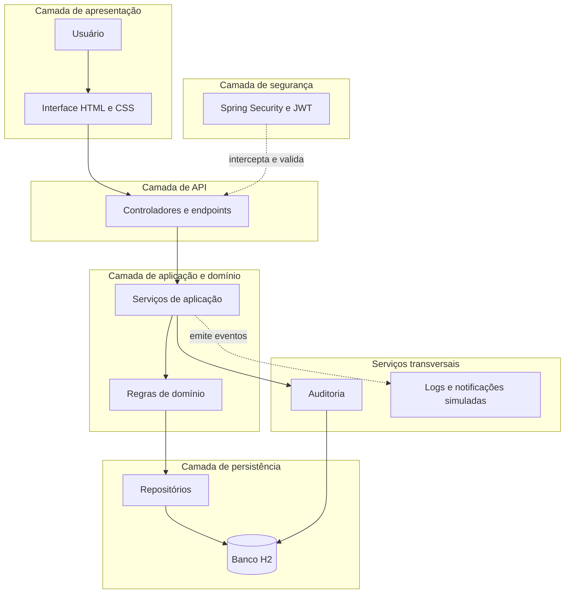
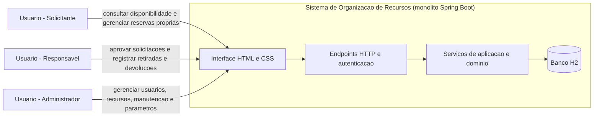
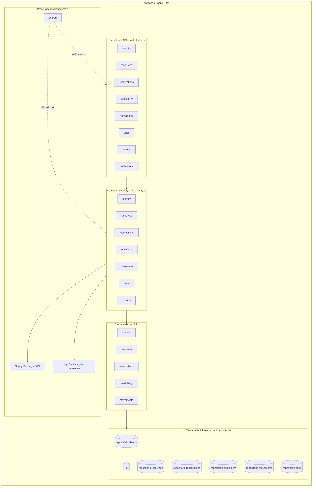
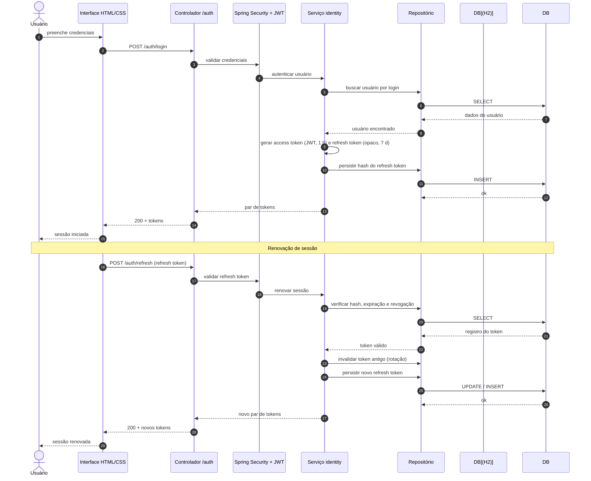
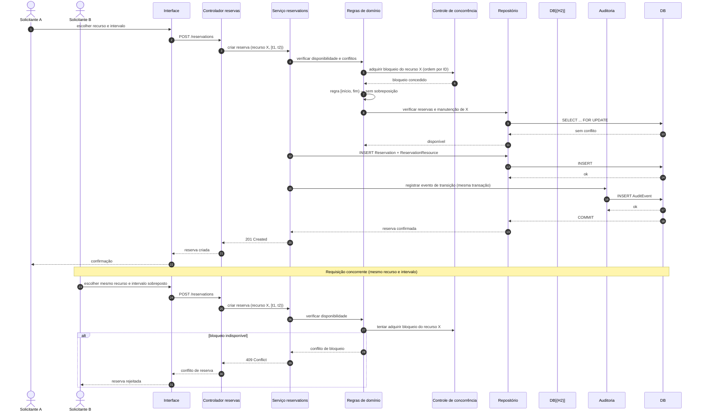
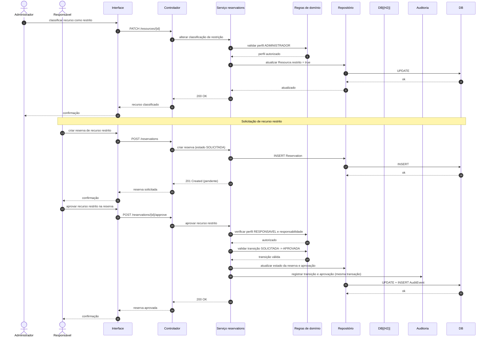
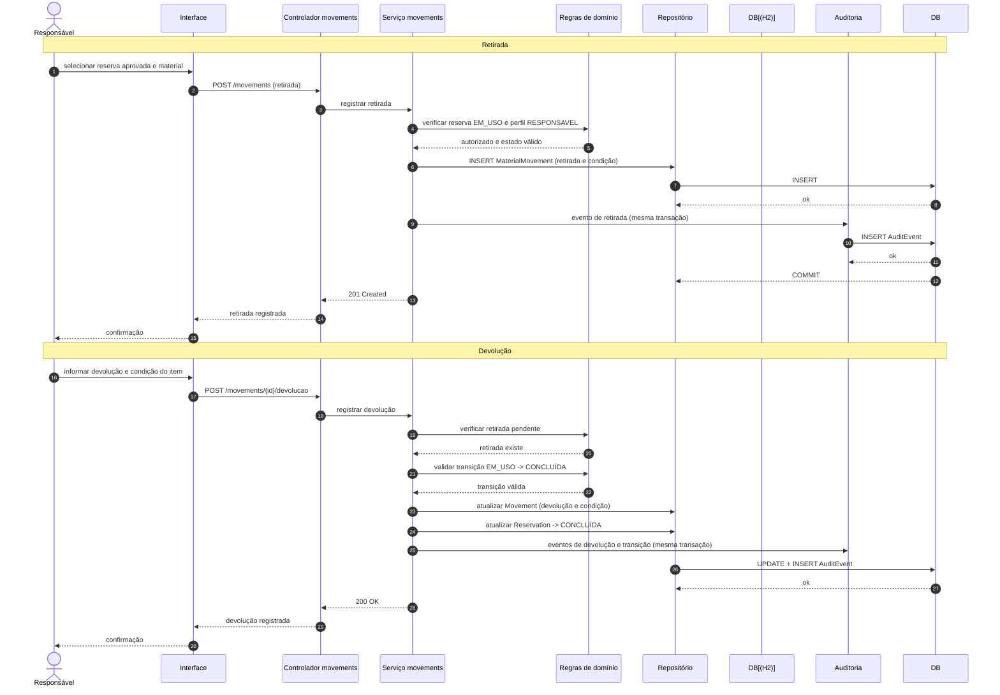

# Arquitetura — Sistema de Organização de Recursos

**Status:** Proposta arquitetural para projeto acadêmico\
**Versão:** 1.0\
**Data:** 15/10/2026\
**Tecnologias-base:** Java, Spring Boot, Spring Security, H2, HTML e CSS\
**Escopo:** Aplicação local, sem infraestrutura de produção externa

## 1\. Objetivo e escopo

Este documento registra as decisões arquiteturais do Sistema de Organização de Recursos, relacionando os requisitos funcionais, não funcionais, regras de negócio, riscos e evidências de qualidade esperadas.

O sistema deverá permitir a gestão de salas, professores, materiais, equipamentos, reservas, períodos de manutenção, movimentações, auditoria e relatórios institucionais.

A arquitetura deverá preservar:

- Integridade das reservas e prevenção de conflitos temporais.
- Proteção contra dupla reserva em requisições concorrentes.
- Autenticação por JWT, com token de acesso e renovação.
- Autorização por perfil e verificação de propriedade das reservas.
- Controle explícito do ciclo de vida das reservas.
- Auditoria persistente das alterações relevantes.
- Desempenho mensurável, testes automatizados e rastreabilidade.
- Facilidade de execução, instalação, demonstração e avaliação acadêmica.

Este documento não substitui o PRD nem os arquivos de requisitos. Quando uma regra funcional ainda não estiver suficientemente definida, a decisão adotada será identificada como premissa acadêmica, sujeita a revisão.

## 2\. Fontes e rastreabilidade

As decisões deste documento são fundamentadas nos seguintes artefatos:

| Fonte | Finalidade |
| --- | --- |
| `README.md` | Contexto geral e objetivo do sistema. |
| `PRD.md` | Tecnologias, personas, regras de negócio, critérios de qualidade e entregáveis. |
| `personas/solicitante.md` | Responsabilidades e restrições do Solicitante. |
| `personas/responsavel.md` | Responsabilidades e restrições do Responsável. |
| `personas/administrador.md` | Responsabilidades administrativas. |
| `rfc/requisitos-funcionais.md` | Requisitos RF-01 a RF-20. |
| `rfc/requisitos-nao-funcionais.md` | Requisitos RNF-01 a RNF-18. |
| `RTM.md` | Matriz de rastreabilidade entre requisitos, riscos, testes e evidências, a ser mantida no repositório. |

Os identificadores RF e RNF não são globalmente únicos entre o PRD e os RFCs. A rastreabilidade deverá registrar o documento de origem, o identificador e, preferencialmente, uma descrição curta do requisito.

## 3\. Contexto e stakeholders

### 3.1. Contexto do sistema

A aplicação será executada localmente, utilizando Java, Spring Boot e banco de dados H2. A interface será renderizada pelo servidor, com HTML e CSS integrados à aplicação.

Não fazem parte do escopo inicial:

- Hospedagem em nuvem ou infraestrutura distribuída.
- Microsserviços ou comunicação entre serviços independentes.
- Dependência obrigatória de APIs externas para reservas, aprovação ou notificações.
- Aplicação móvel nativa.
- Serviço externo de autenticação.
- Serviço externo de mensageria.

### 3.2. Personas

| Perfil | Responsabilidades | Limites de autorização |
| --- | --- | --- |
| Solicitante | Consultar disponibilidade e criar, consultar, alterar ou cancelar as próprias reservas. | Não pode manipular reservas de terceiros nem administrar globalmente os recursos. |
| Responsável | Analisar solicitações especiais, aprovar ou rejeitar solicitações autorizadas e registrar retiradas e devoluções. | Atua sobre solicitações e recursos sob sua responsabilidade; a definição desse vínculo é uma premissa deste documento. |
| Administrador | Gerenciar usuários, recursos, agendas, bloqueios, manutenção e parâmetros globais. | Possui privilégios administrativos, mas não deve contornar validações de integridade, auditoria ou segurança. |

O Administrador também será responsável pela governança da auditoria e pela aprovação das decisões administrativas do projeto, conforme o escopo acadêmico.

## 4\. Estilo e topologia arquitetural

### 4.1. Decisão

**AD-01 — Monólito modular Spring Boot.**

A aplicação será implementada como um único processo executável, dividido em módulos com responsabilidades explícitas.

A comunicação entre módulos ocorrerá por chamadas internas a serviços de aplicação e casos de uso. Os endpoints HTTP serão utilizados para operações disponibilizadas pela interface ou por clientes autorizados.

Essa decisão evita a complexidade operacional de serviços distribuídos e mantém a aplicação compatível com as tecnologias definidas no PRD.

### 4.2. Visão lógica



O diagrama representa a organização lógica proposta, não uma implementação já validada.

### 4.3. Módulos

| Módulo | Responsabilidades |
| --- | --- |
| `identity` | Login, emissão de tokens, renovação, encerramento de sessão e identidade do usuário. |
| `resources` | Cadastro, consulta, classificação e situação de salas, professores, materiais e equipamentos. |
| `reservations` | Criação, alteração, cancelamento, consulta, aprovação e ciclo de vida das reservas. |
| `availability` | Consulta de agendas, bloqueios, manutenção e verificação de conflitos. |
| `movements` | Retirada, devolução e histórico de movimentação de materiais e equipamentos. |
| `audit` | Registro e consulta de alterações relevantes e transições de estado. |
| `reports` | Relatórios gerenciais, filtros e agregações. |
| `notifications` | Produção de notificações simuladas por logs locais. |
| `shared` | Componentes compartilhados estritamente necessários, como tratamento de erros e identificação de usuário autenticado. |

Os módulos deverão evitar dependências circulares. As regras de domínio não devem depender diretamente de controladores HTTP ou de componentes de interface.

### 4.4. Estrutura de pacotes proposta

```
src/
├── main/
│   ├── java/.../organizacaorecursos/
│   │   ├── identity/
│   │   │   ├── controller/
│   │   │   ├── application/
│   │   │   ├── domain/
│   │   │   └── infrastructure/
│   │   ├── resources/
│   │   ├── reservations/
│   │   ├── availability/
│   │   ├── movements/
│   │   ├── audit/
│   │   ├── reports/
│   │   ├── notifications/
│   │   ├── shared/
│   │   └── config/
│   └── resources/
│       ├── templates/
│       ├── static/
│       │   ├── css/
│       │   └── js/
│       └── application.yml
└── test/
    ├── java/.../organizacaorecursos/
    │   ├── unit/
    │   ├── integration/
    │   ├── security/
    │   └── e2e/
    └── resources/
```

A separação física dos diretórios poderá ser adaptada à organização real do código, desde que os limites de responsabilidade sejam preservados.

### 4.5. Diagramas C4 e de sequência

#### 4.5.1. C4 — Contexto



#### 4.5.2. C4 — Componentes



#### 4.5.3. Sequência — Login e renovação do JWT



#### 4.5.4. Sequência — Criação de reserva com concorrência



#### 4.5.5. Sequência — Aprovação de recurso restrito



#### 4.5.6. Sequência — Retirada e devolução de material



## 5\. Modelo de domínio e persistência

### 5.1. Decisão

**AD-02 — H2 como banco relacional oficial do escopo acadêmico.**

O H2 será utilizado para armazenar os dados da aplicação localmente. A configuração de execução deverá declarar explicitamente se o banco funcionará em memória ou em arquivo.

Para a demonstração acadêmica, recomenda-se utilizar H2 em arquivo quando for necessário preservar os dados entre reinicializações. Um perfil de testes poderá utilizar um banco isolado, com dados preparados para cada execução.

O uso de H2 não implica que dados de uma execução em memória sejam preservados após o encerramento da aplicação.

### 5.2. Entidades conceituais

| Entidade | Informações principais |
| --- | --- |
| `User` | Identificador, nome, login, senha armazenada por hash, perfil e situação. |
| `Resource` | Identificador, tipo, descrição, localização, situação e classificação de restrição. |
| `Reservation` | Solicitante, intervalo temporal, estado, finalidade e informações de aprovação. |
| `ReservationResource` | Associação entre reserva e cada recurso alocado. |
| `AvailabilityBlock` | Recurso, intervalo, tipo de bloqueio e justificativa. |
| `Maintenance` | Recurso, período, situação e descrição da manutenção. |
| `MaterialMovement` | Material, reserva, responsável, retirada, devolução e condição do item. |
| `AuditEvent` | Ator, data, ação, entidade afetada, resultado e justificativa quando aplicável. |
| `RefreshToken` | Identificador, usuário, hash do token, expiração, revogação e relação com sua família de renovação. |

A separação entre `Reservation` e `ReservationResource` permite representar uma reserva que envolva mais de um recurso. Essa modelagem é uma decisão proposta e deverá ser simplificada se o escopo funcional aprovado exigir apenas um recurso por reserva.

### 5.3. Regras de integridade

- O término deve ser posterior ao início da reserva.
- O sistema deve rejeitar sobreposição incompatível de intervalos.
- A disponibilidade de todos os recursos associados deve ser verificada antes de confirmar a alocação.
- Reservas não podem utilizar recursos indisponíveis por manutenção ou bloqueio.
- A criação ou alteração da reserva e seus vínculos deve preservar a integridade transacional.
- Transições de estado devem ser validadas pelo domínio.
- A auditoria das transições deve ser persistida na mesma transação da mudança de estado.
- Senhas e refresh tokens não devem ser armazenados em texto puro.

## 6\. Autenticação e autorização

### 6.1. Decisão

**AD-03 — JWT com token de acesso de uma hora e refresh token.**

A autenticação será implementada com Spring Security e JWT. O token de acesso será utilizado nas operações protegidas; o refresh token será utilizado exclusivamente para renovar a sessão.

O JWT de acesso terá validade de 1 hora (3.600 segundos). A validade do refresh token será de 7 dias (604.800 segundos), como premissa acadêmica inicial.

Esses valores são decisões propostas para o projeto, não exigências numéricas do PRD.

### 6.2. Contrato do token de acesso

As requisições protegidas deverão utilizar:

```
Authorization: Bearer <access_token>
```

O token deverá conter, no mínimo, os seguintes claims:

| Claim | Exemplo | Finalidade |
| --- | --- | --- |
| `sub` | `8e...` (UUID completo) | Identificar inequivocamente o usuário. |
| `roles` | `["SOLICITANTE"]` | Representar o perfil autorizado. |
| `iss` | `organizacao-recursos` | Identificar o emissor confiável. |
| `aud` | `organizacao-recursos-api` | Restringir o destinatário do token. |
| `iat` | Timestamp UTC | Registrar a emissão. |
| `exp` | Timestamp UTC | Definir a expiração. |
| `jti` | UUID | Identificar o token individualmente. |

Os timestamps deverão seguir a representação numérica em segundos desde a época Unix, conforme o padrão JWT.

Os valores de `iss` e `aud` deverão ser idênticos aos configurados na validação. O exemplo de `sub` é ilustrativo: na implementação será utilizado um UUID válido.

### 6.3. Algoritmo e chave

A proposta inicial é utilizar RS256, com chave privada para emissão e chave pública para validação.

Regras:

- O algoritmo aceito deverá ser definido pela configuração da aplicação, nunca escolhido livremente com base no cabeçalho do token recebido.
- A chave privada não deverá ser incluída no repositório.
- Chaves de desenvolvimento deverão ser geradas localmente e armazenadas fora do controle de versão.
- O sistema deverá validar assinatura, emissor, audiência, validade temporal e claims obrigatórios.
- O token não deverá conter senha, segredo ou dados pessoais desnecessários.

### 6.4. Refresh token

O refresh token será um valor opaco, aleatório e criptograficamente seguro, sem necessidade de ser um JWT.

A proposta é utilizar 256 bits de entropia, representados por uma codificação adequada para transporte HTTP.

Fluxo de renovação:

1. O usuário realiza login com suas credenciais.
2. A aplicação emite o access token com validade de uma hora e o refresh token com validade de sete dias.
3. Quando o access token expirar, o cliente solicita renovação utilizando o refresh token.
4. O servidor valida o token, sua expiração, seu estado e sua associação ao usuário.
5. O servidor invalida o refresh token utilizado e emite um novo access token e um novo refresh token.
6. O cliente substitui os dois tokens pelos novos valores.
7. Se o refresh token for inválido, expirado ou revogado, a renovação será rejeitada e será necessário autenticar novamente.

O refresh token deverá ser armazenado no banco somente em forma de hash, com identificador, usuário, data de emissão, expiração, revogação e vínculo com a família de renovação.

O sistema deverá permitir encerramento de sessão por revogação do refresh token. Se um token já utilizado for reapresentado, a aplicação deverá rejeitar a renovação e poderá revogar a família correspondente como proteção contra reutilização.

A renovação concorrente deverá ser controlada transacionalmente para impedir que duas requisições utilizem com sucesso o mesmo refresh token.

### 6.5. Endpoints de identidade propostos

| Método | Endpoint | Acesso | Objetivo |
| --- | --- | --- | --- |
| `POST` | `/auth/login` | Público | Autenticar e emitir os tokens. |
| `POST` | `/auth/refresh` | Público com refresh token válido | Renovar os tokens. |
| `POST` | `/auth/logout` | Autenticado | Revogar a sessão de renovação. |
| `GET` | `/auth/me` | Autenticado | Consultar a identidade e os perfis do usuário atual. |

O refresh token deverá ser enviado no corpo da requisição de renovação, por HTTPS quando houver transporte pela rede. Como o escopo inicial é local, não haverá dependência de um provedor externo de identidade.

Em uma interface web, os tokens deverão ser tratados com cuidado para reduzir exposição a scripts maliciosos. A implementação deverá definir o armazenamento do refresh token e adotar proteção contra CSRF se utilizar cookies. Tokens não deverão ser registrados em logs.

### 6.6. Matriz inicial de autorização

| Operação | Solicitante | Responsável | Administrador |
| --- | --- | --- | --- |
| Consultar disponibilidade | Permitido | Permitido | Permitido |
| Criar reserva própria | Permitido | Conforme escopo aprovado | Conforme escopo administrativo aprovado |
| Alterar ou cancelar reserva própria | Permitido, respeitando o estado | Conforme escopo aprovado | Conforme escopo administrativo aprovado |
| Alterar reserva de terceiro | Negado | Apenas sob responsabilidade atribuída | Conforme regra administrativa aprovada |
| Aprovar ou rejeitar solicitação especial | Negado | Permitido quando responsável pela solicitação | Não presumido |
| Registrar retirada ou devolução | Negado, salvo futura regra explícita | Permitido no escopo de responsabilidade | Conforme regra administrativa aprovada |
| Gerenciar usuários e recursos globalmente | Negado | Negado | Permitido |
| Gerenciar manutenção e bloqueios globais | Negado | Negado, salvo delegação aprovada | Permitido |
| Consultar relatórios gerenciais | Conforme escopo próprio aprovado | Permitido | Permitido |

As operações marcadas como dependentes de aprovação funcional não devem receber permissões implícitas. O controle de autorização deverá estar centralizado no Spring Security e nas regras de acesso do serviço de aplicação.

## 7\. Reservas, concorrência e integridade temporal

### 7.1. Decisão

**AD-04 — Validação de conflitos e persistência na mesma transação.**

Uma consulta de disponibilidade anterior à gravação não é suficiente para impedir dupla reserva. Duas requisições podem consultar a mesma disponibilidade antes que qualquer uma persista a reserva.

A implementação deverá combinar:

- Transação para a operação de criação ou alteração.
- Verificação dos intervalos de todos os recursos envolvidos.
- Mecanismo de serialização ou controle de concorrência compatível com H2.
- Tratamento de violações de integridade e conflitos concorrentes.
- Testes que demonstrem o comportamento com requisições simultâneas.

Para a primeira implementação, poderá ser utilizado um bloqueio transacional por recurso ou outra estratégia de serialização comprovadamente compatível com a persistência escolhida.

Se houver múltiplos recursos envolvidos, a aquisição de bloqueios deverá seguir uma ordem determinística, como a ordenação dos identificadores, para reduzir o risco de deadlock.

Uma restrição única convencional sobre recurso e horário não impede, isoladamente, todas as sobreposições entre intervalos arbitrários. A estratégia escolhida deverá ser validada especificamente para essa regra.

### 7.2. Regra temporal

A condição geral de conflito será:

```
inicio_existente < fim_novo
AND
fim_existente > inicio_novo
```

A expressão identifica interseção entre intervalos quando os intervalos são tratados como semiabertos, isto é, `[início, fim)`.

Assim, uma reserva que termine às 10h não conflita com outra que comece às 10h, desde que o negócio adote intervalos semiabertos. Essa convenção é uma decisão proposta e deve ser documentada nos testes.

### 7.3. Resultado de concorrência

Em duas tentativas simultâneas para o mesmo recurso e período incompatível:

- No máximo uma operação poderá confirmar a alocação.
- A outra deverá ser rejeitada com resposta de conflito.
- Nenhuma resposta poderá indicar sucesso se a transação não tiver sido confirmada.
- A falha deverá produzir informação suficiente para diagnóstico sem expor detalhes internos.

O teste deverá verificar o estado final do banco, e não apenas o código HTTP retornado.

### 7.4. Manutenção e bloqueios

Os períodos de manutenção e bloqueio deverão ser tratados como indisponibilidades temporais.

A verificação deverá considerar interseção entre o período solicitado e o intervalo bloqueado. Se o recurso estiver indisponível em qualquer parte do intervalo, a reserva deverá ser rejeitada.

## 8\. Ciclo de vida das reservas

### 8.1. Estados documentados

O PRD define os seguintes estados:

- `SOLICITADA`
- `APROVADA`
- `EM_USO`
- `CONCLUÍDA`
- `REJEITADA`
- `CANCELADA`
- `NÃO COMPARECEU`

O fluxo nominal é:

```mermaid
stateDiagram-v2
    [*] --> SOLICITADA : solicitação de reserva

    SOLICITADA --> APROVADA : aprovação do Responsável
    SOLICITADA --> REJEITADA : rejeição do Responsável
    SOLICITADA --> CANCELADA : cancelamento pelo Solicitante

    APROVADA --> EM_USO : início da utilização
    APROVADA --> CANCELADA : cancelamento antes do início
    APROVADA --> "NÃO COMPARECEU" : ausência registrada

    EM_USO --> CONCLUÍDA : finalização da utilização

    REJEITADA --> [*]
    CANCELADA --> [*]
    "NÃO COMPARECEU" --> [*]
    CONCLUÍDA --> [*]
```

### 8.2. Matriz inicial de transições

A matriz abaixo constitui uma premissa acadêmica proposta, pois os documentos não definem todas as transições nem todos os atores autorizados.

| Estado atual | Estado de destino | Condição proposta |
| --- | --- | --- |
| `SOLICITADA` | `APROVADA` | Aprovação por Responsável autorizado, quando aplicável. |
| `SOLICITADA` | `REJEITADA` | Rejeição por Responsável autorizado. |
| `SOLICITADA` | `CANCELADA` | Cancelamento pelo Solicitante proprietário. |
| `APROVADA` | `EM_USO` | Início da utilização, após as verificações aplicáveis. |
| `APROVADA` | `CANCELADA` | Cancelamento antes do início, conforme a política proposta. |
| `APROVADA` | `NÃO COMPARECEU` | Registro por usuário autorizado após a ausência. |
| `EM_USO` | `CONCLUÍDA` | Finalização da utilização. |

Transições não listadas serão rejeitadas até que uma regra formal seja aprovada.

Reservas em `EM_USO` não poderão ser excluídas. Alterações em reservas iniciadas deverão ser bloqueadas, salvo se uma regra funcional posterior definir explicitamente uma exceção auditável.

### 8.3. Aprovação de recursos restritos

Um recurso classificado como restrito não poderá avançar para `EM_USO` sem aprovação positiva de um Responsável autorizado.

Para o escopo acadêmico, ficam propostas as seguintes regras:

- A restrição será representada por um atributo explícito do recurso.
- O Administrador será o único perfil autorizado a alterar essa classificação.
- A aprovação será registrada na reserva, incluindo usuário, data, decisão e justificativa.
- A ausência de aprovação não será interpretada como aprovação implícita.
- A solicitação permanecerá rastreável enquanto estiver pendente.
- A aprovação de um recurso restrito não dispensará a verificação de disponibilidade, manutenção ou conflito.

A relação entre solicitação especial e recurso restrito será tratada como equivalente na primeira versão. Essa equivalência deverá ser revisada caso os stakeholders identifiquem outras categorias de solicitação especial.

## 9\. Auditoria e notificações

### 9.1. Auditoria

**AD-05 — Auditoria persistente append-only para eventos críticos.**

O registro de auditoria será persistido no H2. Os eventos de transição de estado deverão ser gravados na mesma transação da alteração correspondente.

Cada evento deverá registrar, quando aplicável:

- Identificador do evento.
- Usuário responsável pela ação.
- Data e hora em UTC.
- Tipo de entidade e identificador afetado.
- Ação realizada.
- Estado anterior e estado posterior.
- Resultado da operação.
- Justificativa quando exigida.
- Identificador de correlação da requisição.

A aplicação não deverá disponibilizar operações comuns para editar ou excluir eventos de auditoria. A política de retenção e o acesso administrativo deverão ser documentados.

A imutabilidade será garantida no escopo da aplicação por meio de operações exclusivamente de inclusão e de restrições de acesso. Isso não equivale a uma garantia criptográfica contra alguém com controle direto sobre o arquivo do banco; essa limitação é aceitável para o escopo acadêmico.

### 9.2. Notificações simuladas

**AD-06 — Notificações por logs locais.**

As notificações serão simuladas exclusivamente por logs locais da aplicação, sem integração externa e sem persistência própria de notificações.

Os eventos mínimos serão:

- Solicitação criada.
- Reserva aprovada ou rejeitada.
- Reserva cancelada.
- Início e conclusão da utilização.
- Manutenção cadastrada.
- Retirada ou devolução registrada.
- Falha crítica de operação.

A emissão da notificação não poderá determinar o sucesso da reserva ou da aprovação. Uma falha de logging não deverá reverter uma operação de negócio já confirmada.

## 10\. Relatórios

### 10.1. Relatórios obrigatórios

O módulo de relatórios deverá oferecer:

- Utilização por recurso.
- Carga horária alocada por sala, professor e material.
- Quantidade de reservas por estado.
- Volume de conflitos evitados.
- Histórico de retirada e devolução.
- Indicadores de manutenção e bloqueios.

### 10.2. Filtros propostos

Para harmonizar os critérios do RFC funcional, os filtros iniciais serão:

- Data inicial e final.
- Unidade, quando existir no cadastro.
- Tipo e identificador do recurso.
- Professor ou usuário, conforme o relatório.
- Estado da reserva.

O relatório deverá aplicar autorização ao conjunto de dados consultado. O Administrador e o Responsável poderão acessar os relatórios gerenciais no escopo aprovado.

O significado de unidade será simplificado inicialmente para um identificador organizacional opcional associado aos recursos. Caso não exista uma entidade de unidade no domínio aprovado, esse filtro deverá permanecer indisponível até sua implementação.

Os relatórios deverão permitir apresentação legível dos resultados e, quando viável no escopo acadêmico, exportação em CSV.

## 11\. Desempenho e volumes de referência

### 11.1. Metas documentadas

| Operação | Limite máximo | Alvo |
| --- | --- | --- |
| Consultas de disponibilidade e recursos | 1 segundo | 500 ms |
| Criação, alteração e cancelamento de reservas | 1 segundo | 500 ms |
| Cadastro de manutenção | 1 segundo | 500 ms |
| Relatórios | 5 segundos | 2,5 segundos |

Essas metas são provenientes dos RFCs não funcionais. Elas não definem, por si só, volume de dados, carga simultânea ou percentil de aceite.

### 11.2. Perfil acadêmico de referência

Para permitir a preparação inicial dos testes, propõe-se o seguinte cenário de referência:

| Parâmetro | Valor inicial proposto |
| --- | --- |
| Usuários cadastrados | 100 |
| Salas | 50 |
| Professores | 100 |
| Materiais e equipamentos | 200 |
| Reservas históricas | 10.000 |
| Registros de auditoria | 20.000 |
| Usuários virtuais simultâneos | 20 |
| Taxa-alvo de requisições | 10 requisições/s |
| Duração medida por cenário | 5 minutos |
| Aquecimento | 1 minuto |
| Repetições por cenário | 3 |
| Percentil proposto para aceite | p95 |

Todos os números desta tabela são premissas de teste para o projeto acadêmico, não fatos do PRD nem previsões de uso real. Poderão ser alterados se o ambiente disponível não comportar o cenário.

Para o teste crítico de concorrência, deverá existir um cenário específico com pelo menos 10 requisições simultâneas disputando o mesmo recurso e intervalo, repetido em múltiplas execuções.

O critério principal desse cenário será a integridade: nenhuma execução poderá resultar em dupla alocação confirmada. O tempo de resposta será registrado separadamente.

### 11.3. Método de aferição

Os testes deverão registrar:

- Hardware e sistema operacional.
- Versão do Java e do Spring Boot.
- Configuração do H2 e modo de execução.
- Quantidade e distribuição dos dados.
- Script e versão do teste.
- Tempo de aquecimento e duração medida.
- Média, p95, máximo, throughput e taxa de erros.
- Número de conflitos esperados e efetivamente rejeitados.
- Commit avaliado e resultado final.

O cenário será considerado aprovado quando o p95 respeitar o limite máximo correspondente e a integridade funcional permanecer correta. Os alvos de desempenho deverão ser reportados separadamente.

A adoção do p95 é uma proposta para tornar o aceite reproduzível. Deverá ser identificada como convenção acadêmica no relatório final.

## 12\. Estratégia de testes e qualidade

### 12.1. Pirâmide de testes

| Tipo | Objetivo |
| --- | --- |
| Unitários | Validar regras de domínio e casos de borda isoladamente. |
| Parametrizados | Cobrir diferentes combinações de intervalos, perfis e estados. |
| Integração | Validar persistência, transações, repositórios e configuração de segurança. |
| Segurança | Verificar tokens ausentes, inválidos, expirados, perfis insuficientes e propriedade da reserva. |
| Concorrência | Comprovar que requisições simultâneas não produzem dupla alocação. |
| Caixa-preta | Validar contratos HTTP, respostas e regras observáveis externamente. |
| End-to-end | Executar fluxos completos, incluindo login, reserva, aprovação e conclusão. |
| Carga | Medir as metas de desempenho com Apache JMeter. |

### 12.2. Metas de cobertura

- Cobertura de linhas mínima: 80%.
- Cobertura de branches mínima: 70%.
- Ferramenta de cobertura: JaCoCo.
- Análise estática: SonarCloud.
- Integração contínua: GitHub Actions.
- Desenvolvimento orientado a testes: evidência de TDD ou BDD em pelo menos uma funcionalidade crítica.

Os testes deverão conter asserções reais de negócio. Cobertura numérica isolada não comprova qualidade.

### 12.3. Testcontainers e WireMock

O PRD exige ambiente realista para testes de integração, uso de Testcontainers para persistência e WireMock quando houver integrações externas críticas.

Como a persistência oficial do projeto é H2 local e não há integração externa obrigatória, a configuração de testes deverá documentar explicitamente a estratégia adotada.

A primeira opção será executar testes de integração contra um H2 isolado e reproduzível. Para atender literalmente ao requisito de Testcontainers, deverá ser avaliada e documentada uma configuração de contêiner compatível com H2 ou uma alternativa formalmente aprovada pelos responsáveis pelo projeto. Não se deverá declarar o requisito atendido apenas porque os testes utilizam H2 em memória.

O WireMock será utilizado caso exista uma integração HTTP a simular. Se nenhuma integração externa fizer parte do escopo, essa condição deverá ser registrada na matriz de rastreabilidade, sem inventar uma dependência de produção.

### 12.4. Pipeline

O GitHub Actions deverá executar em cada pull request:

1. Checkout do repositório.
2. Configuração da versão de Java adotada.
3. Compilação.
4. Testes unitários e parametrizados.
5. Testes de integração e segurança.
6. Verificação de cobertura com JaCoCo.
7. Análise estática e Quality Gate do SonarCloud, conforme a configuração do projeto.
8. Publicação dos relatórios de execução como artefatos do pipeline.

A falha de compilação, de testes críticos ou de verificações obrigatórias deverá impedir a aprovação do pipeline.

Os testes de carga poderão ser executados em etapa específica, com script e relatório versionados. A execução em todo pull request somente deverá ser adotada se o custo e a duração forem compatíveis com o ambiente acadêmico.

## 13\. Tratamento de erros e observabilidade

### 13.1. Contratos de erro

A API deverá utilizar respostas consistentes, por exemplo:

| Situação | Código HTTP proposto |
| --- | --- |
| Requisição inválida | 400 |
| Não autenticado | 401 |
| Sem permissão | 403 |
| Recurso inexistente | 404 |
| Conflito de reserva | 409 |
| Erro inesperado | 500 |

As respostas não deverão conter stack traces, senhas, tokens, consultas SQL, caminhos internos ou detalhes sensíveis.

### 13.2. Logs estruturados

Os logs deverão registrar, quando aplicável:

- Data e hora.
- Nível do evento.
- Identificador de correlação.
- Operação.
- Resultado.
- Duração.
- Código de erro.
- Identificador da entidade envolvida, evitando dados pessoais desnecessários.

Credenciais, tokens integrais, chaves privadas e hashes de refresh token não deverão ser registrados.

As notificações simuladas deverão compartilhar o contexto de correlação da operação, sem se tornarem uma dependência para a confirmação transacional.

## 14\. Segurança de entrada e aplicação

A implementação deverá:

- Validar entradas com Bean Validation e regras específicas de domínio.
- Rejeitar intervalos temporais inválidos.
- Aplicar autorização antes de executar operações protegidas.
- Derivar o usuário autenticado do contexto de segurança, e não de identificadores fornecidos livremente pelo cliente.
- Armazenar senhas com algoritmo apropriado de hash, como BCrypt.
- Não armazenar senhas em texto puro.
- Configurar CORS de forma restritiva quando necessário.
- Adotar proteção CSRF se a autenticação utilizar cookies enviados automaticamente pelo navegador.
- Utilizar consultas parametrizadas e mecanismos seguros de persistência.
- Tratar exceções centralmente.
- Manter segredos e chaves fora do repositório.
- Validar os dados novamente na camada de domínio quando necessário para preservar invariantes.

O sistema deverá manter a autorização por perfil separada das verificações de propriedade e responsabilidade. Ter um papel autorizado não significa, automaticamente, poder alterar qualquer reserva.

## 15\. Decisões arquiteturais registradas

| ID | Decisão | Motivo | Consequência principal |
| --- | --- | --- | --- |
| AD-01 | Monólito modular Spring Boot | Simplicidade operacional e aderência ao PRD. | Um único processo executável com módulos separados. |
| AD-02 | H2 relacional local | Tecnologia de persistência documentada. | Limites de durabilidade e concorrência devem ser validados no H2. |
| AD-03 | JWT de acesso de 1 hora e refresh token de 7 dias | Definir autenticação e renovação de sessão. | Necessidade de armazenar e revogar refresh tokens com segurança. |
| AD-04 | Validação transacional de reservas | Prevenir dupla alocação e inconsistências. | Exige estratégia de concorrência e testes reais. |
| AD-05 | Auditoria persistente append-only | Preservar rastreabilidade das alterações críticas. | A aplicação não deve oferecer edição ou exclusão comum de eventos. |
| AD-06 | Notificações simuladas por logs locais | Evitar dependências externas no fluxo principal. | Não haverá consulta ou persistência independente de notificações. |
| AD-07 | Relatórios com filtros e leitura separada | Atender aos relatórios obrigatórios e facilitar aferição de desempenho. | Os filtros dependem da taxonomia funcional aprovada. |
| AD-08 | Testes automatizados e CI | Demonstrar evidências verificáveis de qualidade. | Pipeline e relatórios devem ser mantidos no repositório. |
| AD-09 | Cenário acadêmico de carga documentado | Tornar os testes reproduzíveis sem inventar demanda real. | Os valores serão tratados como premissas, não como requisitos de negócio. |

As decisões são propostas documentais até serem incorporadas ao processo de revisão do projeto. Cada ADR definitivo deverá registrar alternativas consideradas, consequências, riscos, evidências e condições de revisão.

## 16\. Riscos e mitigação

| Risco | Impacto | Mitigação |
| --- | --- | --- |
| Dupla reserva sob concorrência | Violação de regra eliminatória. | Controle transacional, serialização e testes concorrentes. |
| Falha de autorização | Exposição ou modificação indevida de dados. | Spring Security, verificação de propriedade e testes negativos. |
| Uso indevido de refresh token | Renovação não autorizada de sessão. | Hash persistido, rotação, expiração, revogação e proteção contra reutilização. |
| Transições inconsistentes | Reservas em estados inválidos. | Matriz única de transições e testes de domínio. |
| Auditoria incompleta | Perda de rastreabilidade. | Persistência transacional e testes de autoria e histórico. |
| Metas de desempenho sem cenário comum | Evidências não comparáveis. | Scripts versionados, ambiente documentado e percentil explícito. |
| Divergência entre PRD e RFCs | Requisitos ou testes incorretos. | Matriz de correspondência e decisões registradas. |
| Cobertura artificial | Quality Gate sem evidência real de qualidade. | Asserções de negócio e testes críticos rastreados. |
| Falha no ambiente de integração | Pipeline não reproduzível. | Documentação de configuração, dados de teste e dependências. |

## 17\. Rastreabilidade dos principais requisitos

| Requisito de origem | Decisão ou componente | Evidência esperada |
| --- | --- | --- |
| PRD RF-01; RFC RF-01 e RF-19 | `identity`, Spring Security e JWT | Testes de login, expiração, assinatura e autorização. |
| RFC RF-02 e RF-03 | `resources` | Testes de cadastro, filtros e disponibilidade. |
| PRD RN-01 a RN-04; RFC RF-04, RF-06, RF-07 e RF-09 | `reservations` e `availability` | Testes temporais, manutenção e concorrência. |
| PRD RN-05 a RN-09; RFC RF-05 e RF-11 | `reservations` e `audit` | Testes de transição, imutabilidade e autoria. |
| RFC RF-08 e RF-17 | Aprovação de recursos restritos | Testes de autorização e bloqueio sem aprovação. |
| RFC RF-10 | `movements` | Testes de retirada, devolução e histórico. |
| RFC RF-12 | `reports` | Testes de filtros, agregações, consistência e tempo de resposta. |
| PRD RF-13; RFC RF-13 | Interface server-side | Testes dos fluxos e verificação de responsividade. |
| PRD RNF-01 a RNF-05; RFC RNF-03 a RNF-06 | Testes de carga e pipeline | Relatórios do JMeter e evidências de CI. |
| PRD COV-01, COV-02 e QUAL-01; RFC RNF-10 e RNF-11 | Suíte de testes | Relatório JaCoCo e evidências de asserções de negócio. |
| PRD RTM-01 | `RTM.md` | Matriz completa de requisito, risco, teste e evidência. |
| RFC RNF-15 e RNF-16 | `audit` e `notifications` | Logs estruturados e testes de eventos. |

A matriz completa deverá ser mantida no arquivo `RTM.md`, incluindo os requisitos restantes, riscos, identificadores dos testes e links para evidências.

## 18\. Entregáveis arquiteturais

O projeto deverá manter:

- `docs/arquitetura.md`: este documento.
- `docs/adr/`: decisões arquiteturais individuais.
- `docs/diagramas/`: diagramas C4 e sequências críticas.
- `RTM.md`: matriz de rastreabilidade.
- `README.md`: instalação, execução e fluxos principais.
- Configuração do GitHub Actions.
- Relatórios JaCoCo e SonarCloud.
- Scripts e relatórios do JMeter.
- Suíte automatizada de testes.
- Registro de defeitos e relatório final de qualidade.

Diagramas mínimos:

- C4 — Contexto.
- C4 — Componentes.
- Sequência — Login e renovação do JWT.
- Sequência — Criação de reserva com concorrência.
- Sequência — Aprovação de recurso restrito.
- Sequência — Retirada e devolução de material.

A árvore de utilidade deverá relacionar os atributos de qualidade aos cenários mensuráveis, critérios de sucesso e riscos correspondentes.

## 19\. Premissas acadêmicas e limites

As decisões seguintes são adotadas para permitir uma implementação inicial coerente:

- Access token com validade de 1 hora.
- Refresh token com validade de 7 dias e rotação a cada renovação.
- JWT assinado com RS256.
- H2 local como banco oficial do projeto.
- Intervalos de reserva tratados como `[início, fim)`.
- Recurso restrito representado por classificação explícita.
- Solicitação especial tratada inicialmente como solicitação de recurso restrito.
- Apenas Responsáveis autorizados podem aprovar recursos restritos.
- Transições não definidas na matriz serão rejeitadas.
- Notificações simuladas serão produzidas por logs locais.
- Os números de volume e carga da seção 11 são dados de teste acadêmicos, não previsões reais.
- O percentil p95 será utilizado como critério inicial de avaliação de desempenho.

Essas premissas deverão ser identificadas como decisões do projeto, não como requisitos extraídos literalmente do PRD.

## 20\. Conclusão

A arquitetura proposta utiliza um monólito modular com Java, Spring Boot e H2, mantendo a complexidade compatível com um projeto acadêmico e priorizando as regras eliminatórias: execução da aplicação, autorização correta e prevenção de dupla reserva.

O JWT com acesso de uma hora e refresh token rotativo define o ciclo inicial de autenticação. A persistência transacional, a auditoria, a matriz de estados e os testes de concorrência deverão ser implementados e validados antes de considerar os riscos críticos resolvidos.

A documentação arquitetural somente será considerada completa quando os diagramas, os ADRs aprovados, a matriz de rastreabilidade e as evidências automatizadas estiverem efetivamente presentes no repositório.

A conclusão da documentação não significa que a arquitetura já esteja implementada ou que os critérios de aceite tenham sido demonstrados.