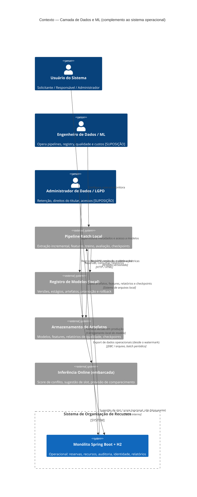
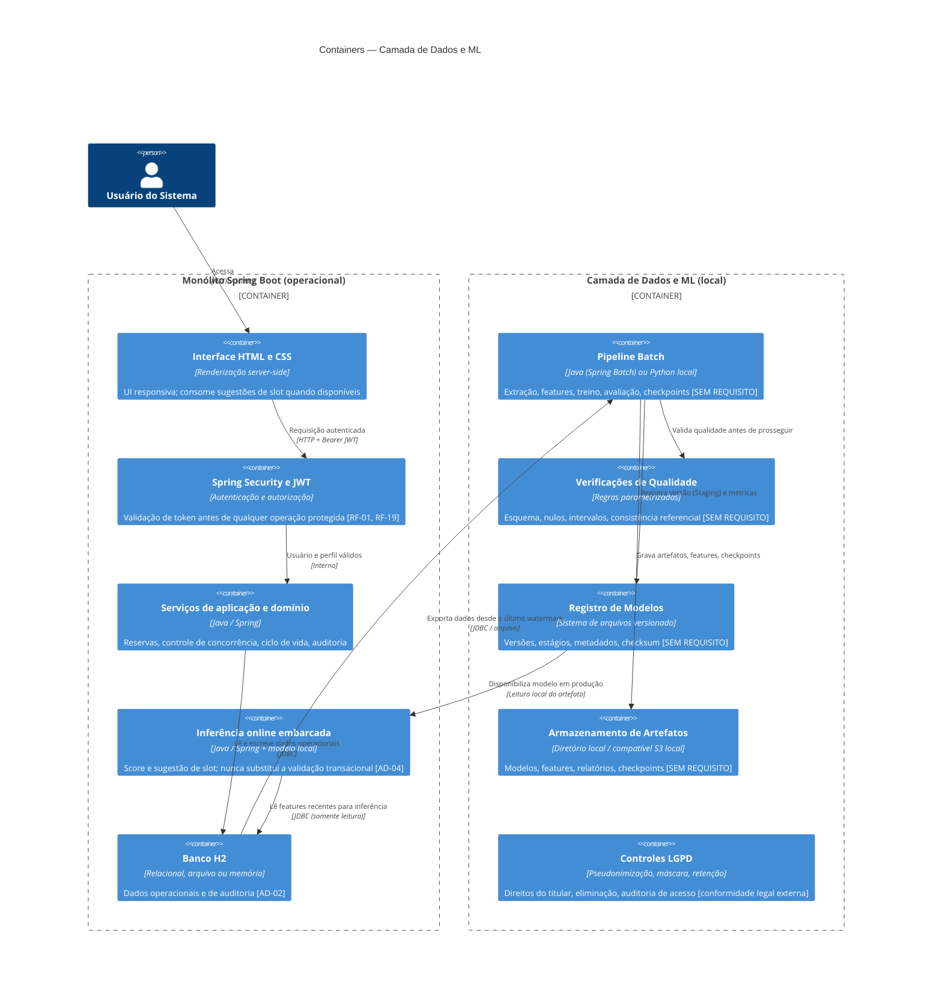
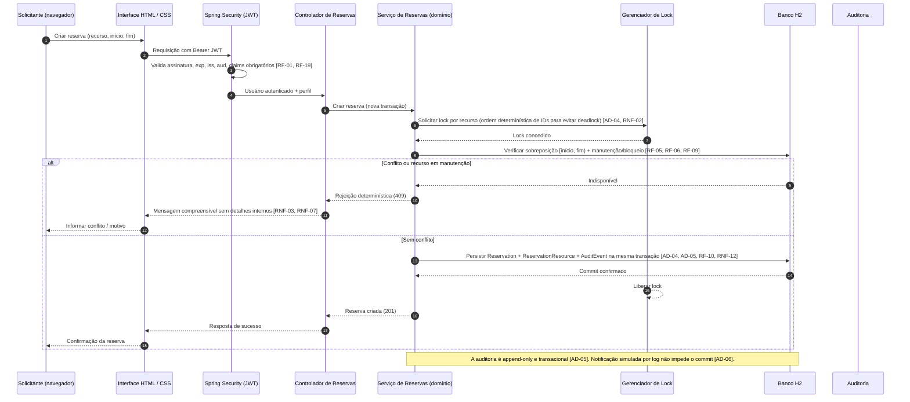

# Complemento Arquitetural — Camada de Dados e ML

**Status:** Proposta complementar (extensão de `docs/arquitetura.md`)\
**Versão:** 1.0\
**Data:** 15/10/2026\
**Base:** `docs/arquitetura.md`, `docs/PRD.md`, `rfc/requisitos-funcionais.md`, `rfc/requisitos-nao-funcionais.md`, `docs/personas/*.md`\
**Escopo do complemento:** camada de dados (batch e online) e operações de ML sobre os dados operacionais do Sistema de Organização de Recursos, executada no mesmo ambiente acadêmico local, sem infraestrutura de nuvem.

## Convenções deste documento

- `[RF-XX]`, `[RNF-XX]`: decisão justificada por requisito existente.
- `[PREMISSA]`: suposição acadêmica assumida para viabilizar o complemento, não extraída de requisito.
- `[SEM REQUISITO]`: decisão sem requisito correspondente no PRD, nos RFCs ou nas personas. É uma escolha de projeto, sujeita a revisão pelos stakeholders.
- Nenhuma decisão deste complemento altera `docs/arquitetura.md` nem o código-fonte. Este arquivo não é fonte de verdade sobre o sistema operacional; é um complemento de engenharia de dados/ML.

---

## 1. Objetivo e escopo do complemento

O monólito Spring Boot + H2 (documentado em `docs/arquitetura.md`) cobre o processamento operacional: cadastros, reservas, concorrência, auditoria e relatórios gerenciais. Este complemento adiciona:

- **Fluxo online:** inferência leve embarcada (score de risco de conflito, sugestão de slot alternativo, previsão simples de não comparecimento) consumida pela interface ou por endpoints internos.
- **Fluxo batch:** extração incremental dos dados operacionais do H2, construção de features, treinamento, avaliação, registro de modelo, promoção e rollback, com checkpoint/watermark e verificações de qualidade.

Este complemento existe apenas para atender aos tópicos solicitados de engenharia de dados/ML (watermark/checkpoint, idempotência, lock/concorrência, retry/recuperação, qualidade e linhagem, reprodutibilidade, validação do modelo, versionamento/registry, promoção, rollback, observabilidade, segurança/LGPD e custos). Nenhum desses tópicos é exigido pelo PRD ou pelos RFCs lidos.

---

## 2. Suposições (fatos ausentes) e alternativas consideradas

| # | Suposição (fato ausente) | Fundamento | Alternativa considerada | Decisão adotada | Requisito |
|---|--------------------------|------------|-------------------------|-----------------|-----------|
| S1 | Não existe requisito de ML, analytics preditivo ou data lake no PRD nem nos RFCs. | PRD RF-01 a RF-20; RNF-01 a RNF-18 não mencionam modelos preditivos. | Não adicionar camada de dados; manter escopo estritamente operacional. | Adicionar camada de dados como complemento delimitado, opcional e acadêmico. | [SEM REQUISITO] |
| S2 | O batch lê dados do H2 via export periódico (JDBC ou arquivo), sem CDC nem mensageria externa. | Escopo local; `docs/arquitetura.md` exclui serviço externo de mensageria. | Debezium/CDC, Kafka, filas externas. | Export local incremental com watermark; sem CDC. | [SEM REQUISITO] |
| S3 | Modelos de ML previstos: (a) previsão de demanda por recurso/horário, (b) score de risco de sobreposição, (c) previsão simples de não comparecimento. | Necessário para justificar a existência da camada de dados. | Apenas relatórios descritivos (já em RF-12). | Incluir ML preditivo mínimo como suporte à decisão de reservas. | [SEM REQUISITO] |
| S4 | O registro de modelos (model registry) é baseado em sistema de arquivos local, versionado, sem servidor externo. | Sem infraestrutura de nuvem permitida no escopo inicial. | MLflow Server, SageMaker Model Registry. | Registry local com versões, estágios e artefatos. | [SEM REQUISITO] |
| S5 | A inferência online é embarcada no monólito (modelo carregado localmente) ou chamada a serviço local colocado, sem microsserviço separado. | `docs/arquitetura.md` exclui microsserviços e comunicação entre serviços independentes. | Serviço Python separado com API HTTP. | Inferência local dentro do monólito ou serviço local acoplado. | [SEM REQUISITO] |
| S6 | Volumes de referência da seção 11 de `docs/arquitetura.md` (10.000 reservas, 20.000 auditoria, 20 usuários simultâneos) servem para dimensionar a camada de dados. | Premissa de teste já documentada na seção 11. | Não há dados de uso real. | Usar volumes acadêmicos para estimativa de custos e dimensionamento. | Premissa (seção 11) |
| S7 | Dados pessoais presentes (nome, login do `User`) tornam o LGPD aplicável, ainda que em escopo acadêmico. | Entidade `User` armazena dados pessoais. | Anonimização total desde a origem (inviável para operação de reservas). | Pseudonimização em exports para ML, direitos do titular, retenção e auditoria de acesso. | Conformidade legal externa (LGPD), não requisito do PRD |

Alternativas rejeitadas (resumo): hospedagem em nuvem, microsserviços, CDC/Kafka, MLflow servidor, serviço de inferência separado, banco analítico externo. Todas são incompatíveis com o escopo acadêmico local de `docs/arquitetura.md`.

---

## 3. Responsabilidades e limites

### 3.1. Atores do complemento

| Ator | Responsabilidades na camada de dados/ML | Limites |
|---|---|---|
| Solicitante | Consulta sugestões de slot e scores quando expostos pela interface. | Não acessa pipeline, registry, artefatos de modelo nem dados de terceiros. |
| Responsável | Pode ser notificado (simulado) sobre previsões de não comparecimento de suas reservas. | Não aprova modelos nem altera regras de qualidade. |
| Administrador | Aprova promoção de modelos (staging → produção) e autoriza rollback. | Não contorna validações de integridade, auditoria, LGPD ou limites do batch. |
| Engenheiro de Dados/ML | [SUPOSIÇÃO] Configura, opera e monitora pipelines batch, registry, verificações de qualidade e checkpoints. | Não altera regras de negócio operacionais do monólito. |
| Administrador de Dados / LGPD | [SUPOSIÇÃO] Define retenção, executa direitos do titular (acesso, correção, eliminação), supervisiona pseudonimização. | Não tem privilégios que contornem auditoria. |
| Sistema (automação) | Executa jobs batch, grava checkpoints, avalia gate de promoção, emite logs e métricas. | Não toma decisões de promoção sem aprovação do Administrador (decisão de projeto). |

### 3.2. Limites arquiteturais do complemento

1. Não há persistência analítica separada além do H2 operacional, do registry local e do armazenamento de artefatos em diretório local.
2. O batch não altera dados operacionais; apenas lê (export) e grava artefatos, métricas e checkpoints.
3. A inferência online nunca substitui a validação de conflito transacional do monólito (AD-04); é apenas sugestão.
4. Nenhum componente de dados depende de rede externa, nuvem ou serviço de mensageria.

---

## 4. Interfaces e contratos

Todos os contratos abaixo são especificações funcionais, não implementação.

### 4.1. Inferência online (opcional)

| Item | Especificação |
|---|---|
| Propriedade | Sugestão de slot alternativo e score de risco de conflito para uma reserva solicitada. |
| Entrada | identificador do recurso, data, duração, horário preferido (sem dados pessoais do titular além do já autenticado). |
| Saída | lista de slots sugeridos com score de confiança e indicação de risco; nenhum dado pessoal de outros usuários. |
| Autenticação | JWT do monólito (mesmo contrato de `docs/arquitetura.md`, seção 6). |
| Modelo | versão ativa ("produção") do model registry local. |
| Falha | se o modelo não estiver disponível, retorna sugestão vazia ou erro controlado; nunca bloqueia a criação da reserva. |
| Justificativa | [SEM REQUISITO] — funcionalidade de suporte à decisão, não exigida pelo PRD. |

### 4.2. Job batch (extração → features → treino → avaliação)

| Item | Especificação |
|---|---|
| Parâmetros de entrada | data de corte, modo (incremental a partir do watermark ou full), identificador do job, chave de idempotência. |
| Saída | dataset de features versionado, artefato do modelo, relatório de avaliação, novo checkpoint/watermark. |
| Idempotência | mesma chave de idempotência + mesmo watermark não reprocessa dados já consumidos. |
| Retentativa | retry com backoff exponencial em falhas transitórias; dead-letter/log para falhas definitivas. |
| Justificativa | [SEM REQUISITO] — batch não é exigido pelo PRD. |

### 4.3. Model registry local

| Item | Especificação |
|---|---|
| Operações | listar versões, registrar versão (estágio Staging), promover (Staging → Producción), arquivar, rollback (reativar versão anterior). |
| Metadata por versão | identificador, data, autor do treino, dataset de treino/validação usado, métricas, hiperparâmetros, caminho do artefato, checksum, estágio. |
| Justificativa | [SEM REQUISITO] |

### 4.4. Relatório de qualidade de dados

| Item | Especificação |
|---|---|
| Conteúdo | checks de esquema, nulos, intervalos de dados, consistência referencial, duplicatas, perfil de colunas, data do corte. |
| Destino | log estruturado + arquivo de relatório versionado ao lado do artefato do batch. |
| Justificativa | [SEM REQUISITO] |

---

## 5. Diagramas C4 (Mermaid)

Os diagramas seguem a sintaxe C4 para Mermaid (`C4Context`, `C4Container`, `C4Component`, `Person`, `System`, `System_Ext`, `Container_Boundary`, `Rel`). São documentação, não implementação.

### 5.1. C1 — Contexto



### 5.2. C2 — Containers



### 5.3. C3 — Componentes (pipeline batch e inferência)

```mermaid
%%{init: {'theme': 'base'}}%%
C4Component
    title Componentes — Pipeline Batch e Inferência Online

    Container_Boundary(b1, "Pipeline Batch (container batch)") {
        Component(ext, "Extrator", "Lê o H2 a partir do watermark do último checkpoint", "Dataset bruto + novo watermark candidato")
        Component(ckpt, "Checkpoint / Watermark", "Persiste ponto de corte, status e chave de idempotência do job", "Permite retomada idempotente após falha")
        Component(dqc, "Qualidade de Dados", "Executa checks de esquema, nulos, intervalos e referências", "Relatório de qualidade; bloqueia o job em falha crítica")
        Component(feat, "Construtor de Features", "Agregações por recurso, horário, perfil e período", "Feature store local versionada")
        Component(train, "Treinador", "Treina modelo (demanda, conflito, não comparecimento)", "Artefato do modelo + métricas de treino")
        Component(eval, "Avaliador", "Holdout / validação cruzada + gate de métricas de negócio", "Aprovação ou rejeição para staging")
        Component(pub, "Publicador de Registro", "Registra versão no model registry", "Versão, estágio Staging, checksum, metadados")
    }

    Container_Boundary(i1, "Inferência Online (dentro do monólito)") {
       Component(model_loader, "Carregador de Modelo", "Carrega a versão ativa (produção) do registry", "Modelo em memória; recarregado após promoção")
        Component(feat_adapter, "Adaptador de Features", "Monta vetor de features a partir de dados recentes do H2", "Somente leitura; sem dados pessoais desnecessários")
        Component(scorer, "Pontuador", "Executa inferência e gera score/sugestão de slot", "Resultado retornado ao solicitante")
    }

    Rel(ext, ckpt, "Lê último checkpoint válido", "")
    Rel(ckpt, ext, "Fornece watermark de corte", "")
    Rel(ext, dqc, "Envia dataset bruto", "")
    Rel(dqc, feat, "Dataset liberado para features", "")
    Rel(feat, train, "Feature store versionada", "")
    Rel(train, eval, "Artefato e métricas de treino", "")
    Rel(eval, pub, "Versão aprovada para Staging", "")
    Rel(pub, registry, "Registra versão", "")
    Rel(model_loader, registry, "Carrega versão em produção", "")
    Rel(feat_adapter, db, "Consulta features recentes", "Somente leitura")
    Rel(scorer, model_loader, "Usa modelo ativo", "")
```

---

## 6. Fluxos de sequência

### 6.1. Online — criação de reserva com controle de concorrência



### 6.2. Online — inferência (sugestão de slot alternativo, opcional)

```mermaid
sequenceDiagram
    autonumber
    participant U as Solicitante
    participant W as Interface HTML / CSS
    participant INF as Inferência Online
    participant ML as Model Registry (versão produção)
    participant DB as Banco H2 (features recentes, somente leitura)

    U->>W: Solicitar sugestão de slot alternativo (recurso, dia, duração)
    W->>INF: Requisição autenticada (JWT)
    INF->>ML: Carregar versão ativa em produção
    ML-->>INF: Artefato do modelo + checksum
    INF->>DB: Consultar ocupação e histórico recente do recurso
    DB-->>INF: Vetor de features (sem dados pessoais de terceiros)
    INF->>INF: Executar inferência local (score por slot candidato)
    INF-->>W: Slots sugeridos com score e risco
    W-->>U: Lista de alternativas
    note over INF: Falha do modelo → sugestão vazia; nunca bloqueia a criação da reserva [SEM REQUISITO]
```

### 6.3. Batch — extração, features, treino, avaliação, promoção

```mermaid
sequenceDiagram
    autonumber
    participant SCH as Agendador Local (cron)
    participant ORC as Orquestrador de Batch
    participant CKP as Checkpoint / Watermark
    participant EXT as Extrator (H2 desde watermark)
    participant DQ as Qualidade de Dados
    participant FEAT as Construtor de Features
    participant TRAIN as Treinador
    participant EVAL as Avaliador
    participant REG as Model Registry
    participant ADM as Administrador (promoção manual)
    participant INF as Inferência Online

    SCH->>ORC: Disparar job (incremental desde último watermark)
    ORC->>CKP: Ler último checkpoint válido + chave de idempotência
    ORC->>EXT: Extrair dados desde o watermark
    EXT->>DQ: Validar esquema, nulos, intervalos, consistência
    DQ-->>EXT: Resultado da qualidade
    alt Falha crítica de qualidade
        EXT-->>ORC: Job interrompido; checkpoint não avança
        ORC-->>SCH: Falha registrada em log e métrica
    else Qualidade OK
        EXT-->>ORC: Dataset + watermark candidato
        ORC->>CKP: Gravar checkpoint de início do job (idempotente)
        ORC->>FEAT: Construir features versionadas
        FEAT-->>ORC: Feature store
        ORC->>TRAIN: Treinar modelo
        TRAIN-->>ORC: Artefato + métricas de treino
        ORC->>EVAL: Avaliar (holdout + gate de negócio)
        alt Gate reprovado
            EVAL-->>ORC: Rejeitado; versão não promovida
            ORC->>CKP: Manter watermark anterior (não avança)
            ORC-->>SCH: Falha de avaliação registrada
        else Gate aprovado
            EVAL-->>ORC: Aprovado para Staging
            ORC->>REG: Registrar versão (estágio Staging)
            ORC->>ADM: Solicitar promoção com evidências de métrica
            ADM->>REG: Promover Staging → Produção (aprovação explícita)
            REG-->>ORC: Versão ativa em produção
            ORC->>CKP: Avançar watermark e gravar checkpoint final
            ORC-->>SCH: Job concluído com sucesso
            REG->>INF: Novo modelo disponível para carregamento local
        end
    end
    note over ORC, CKP: Retry com backoff exponencial em falhas transitórias; dead-letter/log em falhas definitivas [SEM REQUISITO]
```

---

## 7. Mecanismos de engenharia de dados e ML

Cada mecanismo especifica: decisão, justificativa (requisito/atributo ou `[SEM REQUISITO]`), comportamento e limites.

### 7.1. Watermark / checkpoint

**Decisão:** todo job batch grava um checkpoint contendo: identificador do job, data de corte (watermark), status (iniciado/sucesso/falha), chave de idempotência, checksum do dataset de entrada e carimbo de hora UTC. O próximo job retoma a partir do último checkpoint com status de sucesso.

**Justificativa:** reprodutibilidade e recuperação de falhas. `[SEM REQUISITO]` — não há requisito de processamento incremental no PRD.

**Comportamento:**
- O watermark avança apenas após sucesso completo do job (extração → qualidade → features → treino → avaliação → registro).
- Em caso de falha, o checkpoint mantido permite reexecução idempotente a partir do ponto de corte.
- Checkpoints são append-only e nunca editados (alinha-se ao princípio de auditoria em AD-05).

**Limites:** não substitui a transação operacional do monólito; aplica-se apenas ao batch analítico.

### 7.2. Idempotência

**Decisão:** jobs batch e inferência online usam chave de idempotência. No batch, a combinação (identificador do job + watermark) é a chave; no online, cada requisição de inferência pode trazer um `Idempotency-Key` opcional.

**Justificativa:** retry seguro e reprocessamento determinístico. `[SEM REQUISITO]` — o PRD não exige idempotência em endpoints de dados/ML. Indiretamente apoia RNF-02 (determinismo sob concorrência).

**Comportamento:** mesma chave + mesmo watermark → não reprocessa, retorna o resultado armazenado. Diferente watermark → novo processamento.

**Limites:** a idempotência de reserva concorrente já é tratada por AD-04 (lock transacional); este mecanismo é para o pipeline de dados.

### 7.3. Lock e concorrência

**Decisão:** 
- Online (monólito): lock pessimista por recurso, adquirido em ordem determinística de identificadores, dentro da mesma transação da reserva (AD-04, estendido).
- Batch vs online: o batch lê o H2 somente leitura (export/JDBC); não adquire locks sobre dados operacionais, evitando interferir no fluxo online. Se houver leitura durante gravação, usa isolamento de leitura consistente do H2 para o instantâneo do export.

**Justificativa:** AD-04 e RNF-02 exigem prevenção de dupla reserva; a separação batch/online só leitura evita novos conflitos de concorrência. A parte do lock de recurso online é `[RF-06, RNF-02]`; a política de só-leitura do batch é `[SEM REQUISITO]`.

**Comportamento:** no máximo uma operação confirma a alocação; a concorrente recebe 409. O batch nunca escreve no H2 operacional.

**Limites:** deadlock mitigado por ordenação de IDs; não há lock distribuído porque não há serviços distribuídos (AD-01).

### 7.4. Retry e recuperação

**Decisão:** retry com backoff exponencial limitado (ex.: 3 tentativas) para falhas transitórias (leitura do banco, gravação de artefato, carregamento de modelo). Falhas definitivas (qualidade de dados, gate de avaliação, violação de integridade) não são retryáveis; geram log estruturado, métrica de erro e checkpoint mantido sem avançar o watermark. Não há dead-letter queue externa (escopo local sem mensageria); os erros são registrados em log e arquivo de relatório.

**Justificativa:** robustez do batch e recuperação de falhas. `[SEM REQUISITO]` — não há requisito de retry no PRD. Apoia indiretamente RNF-06 (estabilidade sob carga).

**Comportamento:** entre tentativas há espera progressiva; após esgotar tentativas, o job é marcado como falhado, o Administrador é notificado via log simulado e o watermark não avança.

**Limites:** retry nunca se aplica a gravação de reserva operacional (que deve falhar rápido e retornar 409/500 ao cliente).

### 7.5. Qualidade de dados e linhagem

**Decisão:** verificações de qualidade parametrizadas (schema, nulos, intervalos de datas, consistência referencial entre reserva e recurso, duplicatas) executadas após a extração e antes do treino. Linhagem mantida por rastreamento de metadata: origem (tabela H2, data do corte, watermark), transformações aplicadas, destino (feature store, artefato do modelo).

**Justificativa:** confiabilidade dos dados que alimentam o ML. `[SEM REQUISITO]` — não há requisito de quality checks ou data lineage no PRD. Apoia indiretamente RF-11/RNF-12 (rastreabilidade) e QUAL-01 (asserções reais).

**Comportamento:** falha crítica de qualidade interrompe o job e gera relatório; não avança o watermark. Linhagem é registrada em metadata do modelo (dataset de treino/validação usado).

**Limites:** linhagem é de nível de artefato/dataset, não rastreamento de nível de coluna automatizado (escopo acadêmico).

### 7.6. Reprodutibilidade

**Decisão:** todo artefato de modelo é reproduzível a partir de: versão do código do pipeline, versão dos dados (watermark + checksum do dataset de entrada), hiperparâmetros, semente aleatória, versão do Java/Python e bibliotecas, e arquivo de configuração versionado. Treinos usam o mesmo split holdout para a mesma versão de dados.

**Justificativa:** ciência reprodutível e auditoria de modelos. `[SEM REQUISITO]`.

**Comportamento:** retreino com os mesmos inputs produz o mesmo artefato (mesmo checksum), salvo não determinismo intrínseco do algoritmo, que é documentado.

**Limites:** não há containerização de ambiente (Docker) exigida; a reprodutibilidade é em nível de artefatos e configuração versionados.

### 7.7. Validação do modelo

**Decisão:** cada modelo passa por: (1) validação técnica (holdout ou validação cruzada, métricas adequadas ao problema, ex.: MAE/RMSE para demanda, recall/precisião para risco de conflito), (2) gate de negócio (métrica mínima aprovada pelo Administrador de Dados, ex.: score acima de um limiar), (3) teste de sombra opcional (previsões geradas mas não aplicadas) antes da promoção.

**Justificativa:** confiabilidade das predições usadas para sugestão de slot. `[SEM REQUISITO]` — o PRD não exige validação de modelo de ML.

**Comportamento:** o relatório de avaliação é versionado ao lado do artefato. Versões que não passam o gate são arquivadas, não promovidas.

**Limites:** não há exigência de acurácia mínima numérica no PRD; o limiar é uma premissa acadêmica a ser definida.

### 7.8. Versionamento / registry de modelos

**Decisão:** registry local baseado em sistema de arquivos. Cada versão tem: identificador único (semver ou UUID), data, autor, dataset de treino/validação (referência + checksum), hiperparâmetros, métricas, caminho do artefato, checksum do artefato, estágio (Staging / Produção / Arquivado).

**Justificativa:** rastreabilidade de modelos e capacidade de rollback. `[SEM REQUISITO]`.

**Comportamento:** apenas uma versão está em estágio "Produção" por vez. Promoção requer aprovação do Administrador (seção 3.1).

**Limites:** sem servidor de registry externo; sem assinatura criptográfica de artefatos (escopo acadêmico, nota em AD-03 sobre chaves fora do repositório vale por analogia para artefatos sensíveis).

### 7.9. Promoção

**Decisão:** promoção de Staging → Produção é manual, executada pelo Administrador, após: gate de avaliação aprovado, revisão do relatório de qualidade e verificação do checksum do artefato. A promoção é registrada em auditoria (ator, data, versão, decisão, justificativa).

**Justificativa:** controle de mudança e rastreabilidade (alinha com RF-11, RNF-12, AD-05). A exigência de aprovação explícita é `[SEM REQUISITO]` para ML (mas segue o princípio de aprovação do Responsável em RF-07/RN-07 por analogia).

**Comportamento:** a versão promovida fica disponível para carregamento pela inferência online. A versão anterior é movida para "Arquivado" (não excluída).

**Limites:** promoção automática sem gate não é permitida neste escopo.

### 7.10. Rollback

**Decisão:** rollback reativa a versão anterior em Produção, movendo a versão com problema para "Arquivado". É disparado pelo Administrador quando: degradação de métrica em produção, falha de inferência ou incidente confirmado. O rollback é registrado em auditoria com motivo.

**Justificativa:** recuperação rápida de incidentes de modelo. `[SEM REQUISITO]`.

**Comportamento:** a inferência online passa a carregar a versão reativada no próximo ciclo de carregamento (ou imediatamente, se o carregamento for sob demanda). Dados de treino e artefatos da versão revertida são mantidos.

**Limites:** rollback não reverte dados operacionais do H2 (aqueles seguem AD-05); apenas aponta o modelo ativo para uma versão anterior.

### 7.11. Observabilidade

**Decisão:** logs estruturados com: data/hora UTC, nível, identificador de correlação, operação, resultado, duração, código de erro, identificador da entidade (sem dados pessoais desnecessários). Métricas: duração do job, taxa de sucesso/falha, tamanho do dataset, latência de inferência, versão do modelo em produção, quantidade de previsões. Alertas por log para falhas de job, falha de gate e regressão de qualidade.

**Justificativa:** RNF-15 (observabilidade e diagnósticos) e RNF-16 (notificações simuladas) já exigem logs estruturados e rastreio. A extensão para métricas de ML é `[SEM REQUISITO]`.

**Comportamento:** cada etapa do batch emite log com identificador de correlação; a inferência emite latência e versão do modelo usada. Não há dashboard externo (escopo local).

**Limites:** sem tracing distribuído (não há serviços distribuídos, AD-01); sem métricas expostas por Prometheus/Grafana (escopo acadêmico).

### 7.12. Segurança e LGPD

**Decisão:** 
- Pseudonimização de campos pessoais (nome, login) nos datasets exportados para ML e features.
- Retenção definida: dados de treino e artefatos mantidos pelo período necessário ao projeto acadêmico; eliminação sob solicitação do titular (direito LGPD) ou ao final do prazo.
- Acesso ao registry e a artefatos restrito a Administrador e Engenheiro de Dados/ML; auditoria de acesso a dados pessoais.
- Sem senhas ou tokens nos dados de treinamento; JWT nunca entra nos datasets de ML.

**Justificativa:** LGPD (Lei Geral de Proteção de Dados) se aplica aos dados pessoais da entidade `User`. `[SEM REQUISITO DO PRD]` — conformidade legal externa, não requisito funcional do sistema. Apoia RNF-01 (segurança) por analogia.

**Comportamento:** direitos do titular (acesso, correção, anonimização/bloqueio, eliminação, portabilidade, revogação) são atendidos via solicitação ao Administrador de Dados; exclusão é registrada em auditoria.

**Limites:** não há garantia criptográfica de imutabilidade do arquivo H2 (nota já em AD-05); não há DPO formal nomeado (escopo acadêmico).

### 7.13. Custos

**Decisão:** infraestrutura de custo próximo a zero para o escopo acadêmico: máquina local única, H2 em arquivo, armazenamento de artefatos em diretório local, sem nuvem, sem serviço de ML gerenciado, sem mensageria paga. O custo principal é de hardware (amortizado) e tempo-humano de operação do batch.

**Justificativa:** viabilidade acadêmica. `[SEM REQUISITO]` — o PRD não define orçamento nem custos.

**Comportamento:** monitorar crescimento do armazenamento de artefatos (modelos, features) e definir política de retenção para evitar crescimento ilimitado.

**Limites:** não há estimativa financeira numérica porque não há requisito nem provedor de nuvem definido.

---

## 8. Registro de decisões estendido (ADRs)

Estende a tabela da seção 15 de `docs/arquitetura.md` (AD-01 a AD-09 mantidos inalterados).

| ID | Decisão | Motivo / Justificativa | Consequência principal | Alternativas consideradas |
|---|---------|------------------------|------------------------|---------------------------|
| AD-10 | Watermark/checkpoint por job batch | Reprodutibilidade e recuperação de falhas [SEM REQUISITO] | Jobs retomáveis sem reprocessar dados já consumidos | Sem checkpoint (reprocessamento full a cada falha) |
| AD-11 | Chave de idempotência em batch e inferência | Retry seguro e reprocessamento determinístico [SEM REQUISITO] | Mesmo job+watermark não é processado duas vezes | Sem idempotência (risco de duplicação em retry) |
| AD-12 | Lock pessimista por recurso online (ordem de IDs); batch somente leitura | AD-04, RF-06, RNF-02 (dupla reserva); evitar conflito batch/online [SEM REQUISITO para a parte batch] | Integridade temporal preservada; batch não trava operações online | Lock otimista (versão), CDC com lock — rejeitados por complexidade e escopo |
| AD-13 | Retry com backoff exponencial; falhas definitivas não retryáveis | Robustez do batch [SEM REQUISITO] | Recuperação de falhas transitórias sem intervenção manual | Dead-letter queue externa — rejeitado por não haver mensageria (AD-01) |
| AD-14 | Verificações de qualidade parametrizadas e linhagem de artefato | Confiabilidade dos dados de ML [SEM REQUISITO] | Detecção precoce de dados ruins; rastreabilidade de origem | Data lineage automático de coluna — rejeitado por escopo acadêmico |
| AD-15 | Reprodutibilidade via código+dataset+hiperparâmetros+semente versionados | Ciência reprodutível [SEM REQUISITO] | Mesmo input gera mesmo artefato | Containerização Docker — fora do escopo de tecnologias-base |
| AD-16 | Validação técnica + gate de negócio + teste de sombra opcional | Confiabilidade das predições [SEM REQUISITO] | Modelos abaixo do limiar não chegam à produção | Sem validação de modelo — rejeitado por risco de decisão ruim |
| AD-17 | Model registry local em sistema de arquivos (versões, estágios, checksum) | Rastreabilidade e rollback de modelos [SEM REQUISITO] | Uma versão em Produção por vez; histórico mantido | MLflow Server / SageMaker — rejeitados por infra externa |
| AD-18 | Promoção manual Staging → Produção com aprovação do Administrador | Controle de mudança e auditoria [SEM REQUISITO para ML; princípio de RF-07/RN-07] | Mudanças de modelo deliberadas e auditadas | Promoção automática — rejeitada por falta de gate humano |
| AD-19 | Rollback reativa versão anterior arquivada; incidente auditado | Recuperação rápida de incidentes de modelo [SEM REQUISITO] | Tempo reduzido entre incidente e recuperação | Re-treino imediato — mais lento e sem causa raiz conhecida |
| AD-20 | Logs estruturados + métricas de batch e inferência; alertas por log | RNF-15, RNF-16 (observabilidade); extensão de ML [SEM REQUISITO] | Diagnóstico de falhas e regressões | Dashboard/métricas externas — rejeitado por escopo local |
| AD-21 | Pseudonimização, retenção, direitos do titular, acesso restrito | LGPD sobre dados pessoais de `User` [conformidade legal externa, não requisito PRD] | Redução de exposição de PII nos dados de ML | Anonimização total — inviável para operação de reservas |
| AD-22 | Infra local única, armazenamento local, custo de hardware/tempo | Viabilidade acadêmica [SEM REQUISITO] | Custo próximo a zero; sem dependência de nuvem | Nuvem pública / serviço gerenciado — rejeitado por escopo (AD-01) |

---

## 9. Rastreabilidade estendida com requisitos

| Requisito de origem | Componente / mecanismo deste complemento | Evidência esperada |
|---|---|---|
| RF-01, RF-19; RNF-01 | Inferência online usa JWT do monólito; sem token → rejeição | Testes de autenticação no endpoint de inferência |
| RF-05, RF-06, RF-09; RNF-02 | Lock transacional online; batch somente leitura | Teste de concorrência (dupla reserva rejeitada); batch não grava no H2 |
| RF-10, RF-11; RNF-12 | Auditoria de promoção, rollback e acesso a dados | Log de auditoria com ator, versão, decisão |
| RF-12 | Relatórios podem incluir métricas do batch (qualidade, versões de modelo) | Relatórios gerenciais com dados do pipeline |
| RNF-15, RNF-16 | Logs estruturados, métricas, notificações simuladas de falha de job | Logs com correlação; relatórios de execução |
| AD-01 a AD-09 | Mantidos inalterados; este complemento não os sobrepõe | Documentação existente |
| AD-10 a AD-22 | Decisões de dados/ML; grande parte [SEM REQUISITO] | Este documento + checkpoints, registry, relatórios de qualidade |

A matriz completa continua a ser mantida em `RTM.md` (pendente de criação), ligando cada requisito ao risco, teste e evidência.

---

## 10. Riscos adicionais e mitigação

| Risco | Impacto | Mitigação |
|---|---|---|
| Modelo de ML com baixa qualidade gera sugestão ruim de slot | Experiência do usuário prejudicada (não afeta integridade de reserva) | Gate de avaliação, teste de sombra, inferência nunca bloqueante |
| Batch lê dados enquanto H2 é gravado | Leitura inconsistente de features | Export em instantâneo consistente; isolamento de leitura do H2 |
| Vazamento de dados pessoais nos exports para ML | Violação de LGPD | Pseudonimização, colunas mínimas, auditoria de acesso |
| Crescimento ilimitado de artefatos de modelo | Exaustão de armazenamento local | Política de retenção, versionamento com arquivamento, monitoramento de disco |
| Falha de job batch não detectada | Pipeline parado; dados desatualizados | Alertas por log, métricas de sucesso/falha, checkpoint sem avançar |
| Promoção de modelo sem avaliação | Decisões baseadas em modelo não validado | Aprovação manual do Administrador + gate obrigatório |
| Ausência de requisito de ML torna o complemento desnecessário | Esforço fora do escopo do PRD | Complemento delimitado, opcional, marcado [SEM REQUISITO] |

---

## 11. Conclusão

Este complemento adiciona, sobre o monólito Spring Boot + H2 documentado em `docs/arquitetura.md`, uma camada de dados local com fluxos batch e online de ML, incluindo watermark/checkpoint, idempotência, controle de concorrência, retry/recuperação, qualidade e linhagem de dados, reprodutibilidade, validação de modelo, versionamento/registry, promoção e rollback, observabilidade, segurança/LGPD e controle de custos.

Quase todas as decisões de dados/ML são marcadas como `[SEM REQUISITO]` ou `[PREMISSA]`, pois o PRD, os RFCs e as personas não exigem processamento analítico nem modelos preditivos. O complemento é, portanto, opcional e sujeito à aprovação dos stakeholders antes de qualquer implementação. Nenhuma decisão deste documento altera `docs/arquitetura.md`, os RFCs, o PRD nem o código-fonte do sistema.

A documentação estará completa quando este complemento, os diagramas C4, as sequências, os ADRs aprovados e a matriz de rastreabilidade em `RTM.md` estiverem presentes no repositório — sem que isso signifique implementação realizada ou critérios de aceite demonstrados.